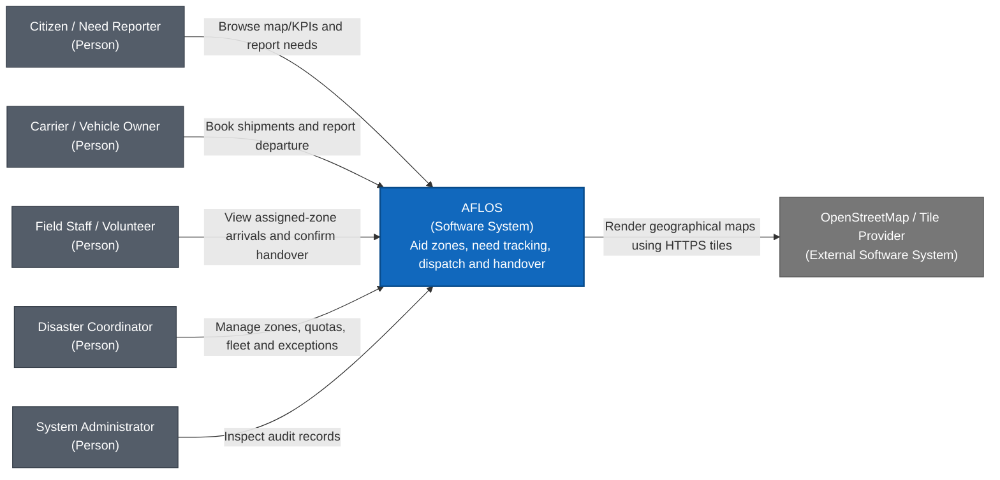
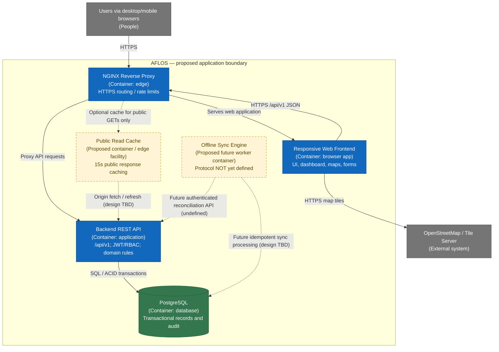
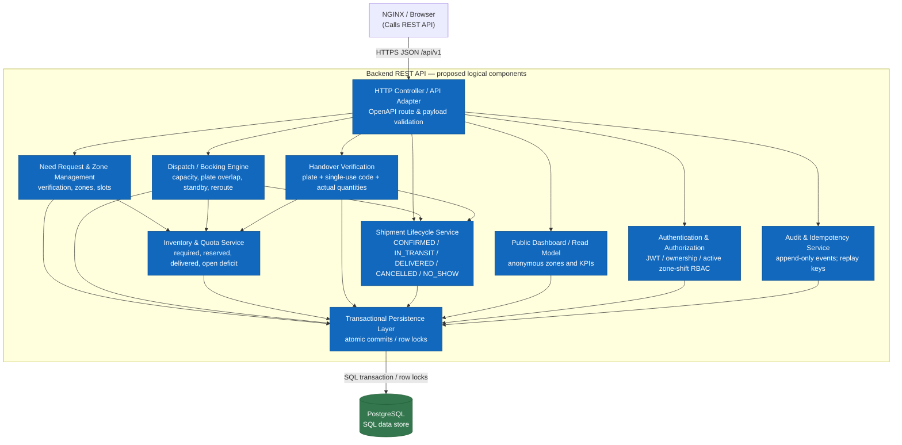

# AFLOS — C4 Architecture Model & Architectural Decision Records

**Course:** SENG 321 / BM 321 — Sprint 2  
**Issue:** [#30 — C4 Architectural Modeling](https://github.com/CoskunerBerke/AFLOS/issues/30)  
**Document owners:** `@kurdoglu25` and `@akgozmirza` (Lead Architects)  
**Status:** **Review-ready architecture proposal**, not proof of an implemented system  
**Contract baseline:** `api/openapi.yaml` (OpenAPI 3.1.0, API v0.1.0)

## 1. Purpose, sources, and modeling conventions

AFLOS is an API-first disaster logistics and aid coordination platform. This document addresses C4 Level 1 (System Context), Level 2 (Containers), Level 3 (Components), and Architecture Decision Records (ADRs). It describes a **proposed implementation architecture** grounded in the current API contract; the OpenAPI file is a **design contract, not an operating backend**.

**Sources:**

1. `api/openapi.yaml` — route, role, request, response, and domain-behavior contract (23 paths; multiple operations per path).
2. `docs/architecture/03-openapi-draft-guide.md` — updated Product Owner decisions, transaction, privacy, and offline limitations.
3. `docs/requirements/02-system-vision-and-boundary.md` — actors, boundaries, external mapping service and deployment constraints; some older prose is superseded by the newer contract.
4. Issue #30 — explicit request for context, container and component views plus architectural decisions.

**Precedence:** Latest explicit Product Owner decision > active backlog > older vision/proposal wording, as described in the architecture guide. Check the current Sprint 2 SRS before final PR approval.

**Diagram notation:** GitHub-compatible Mermaid `flowchart` diagrams using C4 vocabulary. Every box indicates a **person**, **software system**, **container**, or **component**; arrows state purpose/protocol. These diagrams follow the C4 *abstraction levels* but are not the dedicated C4-PlantUML/Structurizr shape library. Dashed and labeled boxes are **proposed, unconfirmed capabilities**; solid boxes likewise represent architectural design, **not evidence of deployed software**.

### 1.1 Contract reconciliation — do not model stale requirements as current behavior

| Topic | Current contract position | Modeling consequence |
|---|---|---|
| Booking | `POST /carrier-applications` immediately books a slot and creates a `CONFIRMED` shipment, subject to atomic validation | **No normal manual carrier approval queue** |
| Shipment states | `CONFIRMED`, `IN_TRANSIT`, `DELIVERED`, `CANCELLED`, `NO_SHOW` | Avoid `APPROVED`, `EXPIRED`, and `REROUTED` as shipment states |
| Handover | License plate + secret single-use code + actual delivered quantities | Dynamic QR is beyond MVP |
| Offline operations | Coordinator fallback at `/handover/fallback` still needs connectivity **at the coordinator** | Do not claim an implemented offline sync protocol |
| Personal data | Public responses mask reporter contacts, plates and codes; TCKN not collected in current API baseline | Do not add TCKN service or public PII flows |
| Maps | External map tiles are outside the AFLOS domain API | Show OpenStreetMap as an external system |

## 2. C4 Level 1 — System Context

### 2.1 System context diagram



**Explanation:** At Level 1, AFLOS is **one box**. Its API, browser frontend, database and cache are internal implementation concerns and appear only at Level 2. Map-tile access may be initiated by browser-side map code; this contextual arrow expresses the overall dependency, not an assertion that the backend must proxy tiles.

### 2.2 Actors and API evidence

| Person/system | Responsibilities | Relevant current contract |
|---|---|---|
| Citizen (`PUBLIC` / `REPORTER`) | View anonymous KPIs/zone map; submit need report | `GET /dashboard/summary`, `GET /aid-zones`, `POST /need-requests` |
| Carrier (`CARRIER`) | Book a time slot; manage owned shipments; register standby vehicle | `POST /carrier-applications`, `PATCH /shipments/{shipmentId}/status`, `POST /standby-fleet` |
| Field staff (`FIELD_STAFF`) | Confirm physical handovers for assigned zone/shift | `POST /handover/verify` |
| Coordinator (`COORDINATOR`) | Create zones and needs; assign standby vehicles; run emergency fallback | `POST /aid-zones`, `POST /aid-zones/{zoneId}/needs`, `POST /standby-fleet/{standbyId}/assign`, `POST /handover/fallback` |
| Administrator (`ADMIN`) | Inspect immutable governance audit records | `GET /admin/audit-logs` |
| Map-tile provider | Serve map imagery/layers | External HTTPS tile dependency; **not** an AFLOS API path |

## 3. C4 Level 2 — Container Diagram

A C4 *container* is a separately running application or data store (not necessarily a Docker container). The following shows a candidate deployable breakdown. Names **do not imply** those services are already implemented.



### 3.1 Container responsibilities and protocols

| Container | Function | Primary communication | Evidence / status |
|---|---|---|---|
| Responsive Web Frontend | Accessible web/mobile-browser UI, public dashboard, role-specific forms and map | HTTPS/JSON to API; HTTPS to map tiles | Responsive web mandated by vision; UI framework not selected |
| NGINX Reverse Proxy | Edge routing, security headers, proposed rate limits, public caching integration | HTTPS client requests to web/API | Listed in Sprint 1 single-command deployment target |
| Backend REST API | Expose OpenAPI 3.1 operations; enforce role/zone authorization, quotas, reservations, handover and audits | REST `/api/v1`, JSON, SQL to PostgreSQL | Defined as contract; implementation not yet proven |
| PostgreSQL | Store zones, slots, needs, vehicles, shipments, codes (securely), assignments, audit and idempotency data | SQL in atomic transactions | Named in Sprint 1 deployment constraints; schema not finalized |
| Public Read Cache | Cache only approved anonymous GET responses for up to 15 seconds; protected/authenticated responses must be `no-store` | HTTP edge cache or separate cache facility | **Proposed placement**, not proof of Redis or a deployed standalone cache |
| Offline Sync Engine | Potential future queue/reconciliation engine for intermittent connectivity | **Protocol and endpoints TBD** | Requested by Issue #30 but **not defined by current OpenAPI**; dashed placeholder only |

**Current offline fallback is not an Offline Sync Engine.** `POST /handover/fallback` lets a coordinator with network access complete field-reported deliveries; the contract explicitly says the coordinator still requires internet access. Designing a genuine offline queue requires an agreed client storage policy, authentication/expiry rules, conflict resolution, sync endpoints and replay semantics. Those are **not approved by the current contract**.

**Cache clarification:** The OpenAPI contract already specifies `Cache-Control: public, max-age=15` on public GETs and `no-store` on authenticated responses. A dedicated cache application is **optional**; the box above represents a proposed capacity/edge concern to satisfy the Issue's requested architecture discussion, not a commitment to Redis.

**Deployment caveat:** Only the baseline target of NGINX, frontend, REST API and PostgreSQL is specified. Additional cache/worker services must not be presented as already deployed under Docker Compose.

## 4. C4 Level 3 — Backend API Component Diagram

This view zooms into the **Backend REST API** container from Level 2. Components are logical responsibilities within the application, not microservices or deployed processes.



### 4.1 Component-to-endpoint traceability

| Logical component | Representative contract paths | Key responsibility |
|---|---|---|
| HTTP adapter + RBAC | All operations; `POST /auth/token` (supporting) | Validate payloads, bearer tokens, role/ownership and dynamic zone-shift access |
| Need & Zone Management | `POST /need-requests`, `POST /need-requests/{requestId}/review` (supporting), `POST /aid-zones`, `POST /aid-zones/{zoneId}/needs` | Need intake, trusted zone creation and time slots |
| Dispatch / Booking Engine | `POST /carrier-applications`, `POST /standby-fleet`, `POST /standby-fleet/{standbyId}/assign` (supporting), `POST /shipments/{shipmentId}/reroute` (supporting) | Atomically check slot and vehicle restrictions and create bookings |
| Inventory & Quota Service | Shared by booking/zone/handover operations | `openDeficit = max(0, requiredQuantity - reservedQuantity - deliveredQuantity)` |
| Shipment Lifecycle | `PATCH /shipments/{shipmentId}/status`, cancellation/no-show supporting operations | Enforce state transitions, no duplicate reservations |
| Handover Verification | `POST /handover/verify`, `POST /handover/fallback` | Validate plate/code or coordinator fallback; reconcile actual quantities |
| Public Read Model | `GET /dashboard/summary`, `GET /aid-zones`, `GET /aid-zones/{zoneId}` | Anonymous/public data only; 15-second freshness allowance |
| Audit & Idempotency | `GET /admin/audit-logs`; all state-changing operations | Append-only audit, replay-safe idempotency keys |

**Critical invariants anchored in the contract:**

1. Booking creates `CONFIRMED` in one database transaction; full slot, overlap, invalid vehicle type or exceeded item need results in `409 Conflict`, not partial reservations.
2. `assignedVehicles` includes `CONFIRMED`, `IN_TRANSIT` and `DELIVERED` bookings; delivery does **not** reopen time-slot capacity. `CANCELLED` and `NO_SHOW` release quota according to contract rules.
3. On physical delivery, subtract the **entire pledged reservation** and add **actual delivered quantity** per item; do not sum incompatible units or double-count on repeated calls.
4. Only `CONFIRMED` can transition to `IN_TRANSIT` via the carrier departure operation; handover requires `IN_TRANSIT` and produces `DELIVERED`.
5. Field authorization must check current assignment and shift, not trust stale JWT zone claims alone; `ADMIN` does not automatically inherit coordinator operations.
6. State-changing operations carry `Idempotency-Key`; audit events and idempotency results should commit atomically with domain changes. Never log secret verification codes.

### 4.2 Offline concern (no invented contract component)

A true *Offline Sync Service* does **not** appear as an existing API feature in `api/openapi.yaml`. Consequently it is **not shown as a functioning backend component** here. The Level 2 dashed worker is an explicit extension placeholder for discussion with the Product Owner and co-architect. The supported current emergency strategy is coordinator fallback while the coordinator is connected.

## 5. Architectural Decision Records (ADRs)

ADRs below separate **documented requirements** from **proposed architecture decisions**. The team should explicitly approve the proposed items; statuses are not claims of team consensus.

### ADR-001 — API-first contract and role-scoped services

- **Status:** Required by existing course/project contract; proposed component decomposition.
- **Context:** Multiple user roles and operational workflows must share consistent semantics.
- **Decision:** Treat `api/openapi.yaml` (OpenAPI 3.1.0) as the REST interface contract under `/api/v1`. Organize internal components around zones/needs, booking/dispatch, handover, identity and audit. Apply roles and ownership checks per request.
- **Consequences:** Frontend/backend can evolve against one contract; breaking interface changes require OpenAPI and architecture updates. OpenAPI `x-roles` documentation alone is not an authorization enforcement mechanism.
- **Evidence:** `openapi.yaml` plus architecture guide §§1–3, 6.

### ADR-002 — PostgreSQL transactional consistency for booking and inventory

- **Status:** PostgreSQL is specified in Sprint 1 deployment constraints; transaction design is required by current guide, not implemented/proven.
- **Context:** Simultaneous carriers can attempt to take the last slot or pledge the same remaining inventory.
- **Decision:** Use PostgreSQL ACID transactions and row-level locking for relevant slot, need, vehicle, shipment, idempotency and audit updates. Roll back the entire booking if any rule fails.
- **Consequences:** Predictable 201/409 outcomes and no over-allocation; lock ordering and concurrency tests are necessary. The exact schema/indexes are to be designed with Issue #31.
- **Evidence:** system vision §5.1; architecture guide §§3, 8.

### ADR-003 — Responsive web frontend behind NGINX

- **Status:** Deployment/web constraints documented; exact frontend/backend frameworks **undecided**.
- **Context:** Citizens, drivers, staff and coordinators need access without installing a native app.
- **Decision:** Design a responsive browser application exposed through an NGINX edge, with a REST API and PostgreSQL as the baseline Docker Compose deployment group. The browser obtains map tiles from an external map provider.
- **Consequences:** Mobile-browser access and simpler release; connectivity is normally required for API operations. Do not claim a native app or preselect a JavaScript framework without team approval.
- **Evidence:** system vision §§3, 5.1; architecture guide §5.

### ADR-004 — Public 15-second caching; confidential data never shared-cached

- **Status:** Contractual HTTP caching policy; cache technology/location **proposed**.
- **Context:** Public map/KPI reads may spike dramatically during a disaster; personalized data must not leak.
- **Decision:** Set public GETs to `Cache-Control: public, max-age=15` where the contract allows; protected endpoints and verification-code responses use `Cache-Control: no-store`. Apply rate limiting at the edge. Evaluate NGINX HTTP cache first; choose a separate cache service only if justified.
- **Consequences:** Public KPI values can be briefly stale; avoid caching private responses. A Redis deployment is **not** established by the source documents.
- **Evidence:** architecture guide §§4, 6; `openapi.yaml` response headers.

### ADR-005 — Offline emergency fallback versus future sync engine

- **Status:** Coordinator fallback **defined**; offline sync engine **unresolved future proposal**.
- **Context:** A disaster-site device may be offline even while a central coordinator retains communication access (e.g., field radio reports).
- **Decision:** For the current contract, model `POST /handover/fallback` as a **connected coordinator operation** with a mandatory justification. Keep the Offline Sync Engine as a **dashed Level 2 future placeholder**, with no claimed API or automatic reconciliation behavior.
- **Alternatives needing PO agreement:** Browser-local queued events + replay protocol; dedicated background worker; no automatic offline sync in MVP.
- **Consequences:** The baseline contract does not support field-device offline synchronization. To approve a true sync solution, specify endpoints, idempotency, token expiry, event ordering, conflict handling, retention, and privacy/security protections, and update OpenAPI/SRS first.
- **Evidence:** `openapi.yaml` `POST /handover/fallback` explicitly says coordinator internet is still needed; architecture guide §4.

### ADR-006 — Auditable state transitions and idempotent writes

- **Status:** Contract requirements; proposed implementation architecture.
- **Context:** Replayed submissions or retries during poor connectivity must not duplicate inventory adjustments or handovers.
- **Decision:** Require `Idempotency-Key` for state-changing operations; bind the key to actor/method/path/payload and preserve results for the contractual 24-hour replay period. Write append-only audit events within the same transaction as successful state changes. Protect one-use verification codes and do not expose or log them.
- **Consequences:** Safer retries, better post-incident accountability and testable invariants; requires carefully designed persistence and cleanup policy.
- **Evidence:** architecture guide §§3, 6, 7–8; contract path descriptions.

## 6. Requirements and deliverable traceability

| User story | Representative API contract | Primary C4 component |
|---|---|---|
| US-01 | `POST /need-requests` | Need Request & Zone Management |
| US-02 | `GET /dashboard/summary`, `GET /aid-zones`, `GET /aid-zones/{zoneId}` | Public Read Model |
| US-03 | `POST /aid-zones` | Need Request & Zone Management |
| US-04 | `POST /aid-zones/{zoneId}/needs` | Inventory & Quota / Zone Management |
| US-05 | `POST /carrier-applications` | Dispatch / Booking Engine |
| US-06 | `PATCH /shipments/{shipmentId}/status` | Shipment Lifecycle |
| US-07 | `POST /handover/verify` | Handover Verification |
| US-08 | `POST /handover/fallback` | Handover Verification |
| US-09 | `POST /standby-fleet` | Dispatch / Booking Engine |
| US-10 | `GET /admin/audit-logs` | Audit & Idempotency |

### Definition of Done — pre-PR validation

- [x] Level 1: actors, AFLOS boundary, external map provider
- [x] Level 2: web, edge, REST API, PostgreSQL; **proposed** cache/offline worker clearly distinguished
- [x] Level 3: core API components with operation-level mapping and transaction invariants
- [x] ADRs: contract, PostgreSQL, deployment, caching, offline scope, audit/idempotency
- [x] Cross-references to API contract and US-01…US-10 provided
- [ ] Co-architect reviews the proposed decomposition and technology assumptions
- [ ] Product Owner confirms alignment with the **active Sprint 2 SRS** and whether genuine offline sync is required for MVP
- [ ] GitHub Mermaid previews checked in Pull Request
- [ ] PR reviewed and approved; Issue #30 closed only after required approvals

**Review questions for `@akgozmirza` / Product Owner:**

1. Do we keep the current coordinator-connected fallback as the Sprint 2 deliverable, with offline sync as a documented future extension, or expand the API/SRS to support local queue + secure synchronization?
2. Is a separate public read cache required, or are NGINX/HTTP cache headers enough for the MVP?
3. Have the latest Sprint 2 SRS and backlog replaced all outdated manual carrier approval and dynamic QR wording?
4. Which technology choices (frontend/backend language/framework, cache implementation) have actually been approved? Record approvals before changing ADR status.

---

*This document models a proposed architecture for classroom review. It does not assert that the frontend, API, database, cache, or offline worker have already been built or deployed.*

## Appendix A — Native C4 notation source (Structurizr DSL)

The Mermaid diagrams above are GitHub-readable previews of C4 concepts. For review against the Issue's **official C4 notation** criterion, the same high-level architecture is also described below in **Structurizr DSL**, which supports native System Context / Container / Component C4 views. This is an *additional modeling source*, not a deployed system. Copy this DSL into a `.dsl` workspace and render using a compatible Structurizr tool if formal C4 shapes are required. The DSL has not been executed in a renderer in this document.

```text
workspace "AFLOS" "Sprint 2 C4 architecture proposal" {
    model {
        citizen = person "Citizen / Reporter" "Views aid zones and submits need reports"
        carrier = person "Carrier" "Books a delivery and tracks shipments"
        field = person "Field Staff" "Verifies deliveries in assigned zones"
        coordinator = person "Coordinator" "Manages zones, fleet and exceptions"
        admin = person "Administrator" "Inspects governance audit records"

        tiles = softwareSystem "Map Tile Provider" "OpenStreetMap tile service" {
            tags "External"
        }

        aflos = softwareSystem "AFLOS" "Disaster logistics and aid coordination" {
            proxy = container "NGINX Edge" "Routes browser and API requests" "NGINX"
            web = container "Responsive Web Frontend" "Maps, forms and role-scoped UI" "Browser application"
            api = container "Backend REST API" "Enforces OpenAPI contract and domain invariants" "HTTP / JSON" {
                router = component "API Controller" "Routes and validates HTTP operations"
                auth = component "Auth and RBAC" "Checks identity, ownership, zone and shift"
                zones = component "Zone and Need Service" "Manages zone, slot and need records"
                booking = component "Dispatch and Booking Engine" "Reserves slots and items atomically"
                inventory = component "Inventory Accounting" "Tracks required, reserved and delivered quantities"
                lifecycle = component "Shipment Lifecycle" "Enforces valid shipment status transitions"
                handover = component "Handover Verification" "Validates delivery and actual quantities"
                dashboard = component "Public Read Model" "Exposes sanitized public data"
                audit = component "Audit and Idempotency" "Prevents replays and records append-only audits"
                persistence = component "Transactional Persistence" "Coordinates SQL transactions and row locks"
            }
            db = container "PostgreSQL" "Durable business and audit records" "PostgreSQL" {
                tags "Database"
            }
            cache = container "Public Read Cache (proposed)" "Optional 15-second public read cache" "TBD" {
                tags "Proposed"
            }
            sync = container "Offline Sync Engine (proposed)" "Future extension; no current sync contract" "TBD" {
                tags "Proposed"
            }
        }

        citizen -> aflos "Views KPIs and reports needs"
        carrier -> aflos "Books deliveries and manages shipments"
        field -> aflos "Verifies physical handovers"
        coordinator -> aflos "Operates aid logistics and fallback"
        admin -> aflos "Reviews audit records"
        aflos -> tiles "Uses external map tiles"

        citizen -> proxy "Uses" "HTTPS"
        carrier -> proxy "Uses" "HTTPS"
        field -> proxy "Uses" "HTTPS"
        coordinator -> proxy "Uses" "HTTPS"
        admin -> proxy "Uses" "HTTPS"
        proxy -> web "Delivers browser application" "HTTPS"
        web -> proxy "Calls REST endpoints" "HTTPS /api/v1"
        proxy -> api "Reverse proxies requests" "HTTP / JSON"
        web -> tiles "Downloads map tiles" "HTTPS"
        api -> db "Reads and writes records" "SQL / ACID"
        cache -> api "Potential cache refresh" "HTTP (TBD)"
        sync -> api "Future authenticated synchronization" "Protocol TBD"

        router -> auth "Authorizes protected operations"
        router -> zones "Delegates zone and needs calls"
        router -> booking "Delegates carrier and standby calls"
        router -> lifecycle "Delegates status changes"
        router -> handover "Delegates handover calls"
        router -> dashboard "Delegates public reads"
        router -> audit "Delegates audit requests"
        booking -> inventory "Checks inventory deficit"
        booking -> lifecycle "Creates confirmed shipment"
        handover -> inventory "Reconciles actual quantities"
        handover -> lifecycle "Marks shipment delivered"
        zones -> persistence "Persists zone and need changes"
        booking -> persistence "Runs atomic booking"
        inventory -> persistence "Locks and changes item quantities"
        lifecycle -> persistence "Stores state transitions"
        handover -> persistence "Commits handover"
        dashboard -> persistence "Reads sanitized records"
        auth -> persistence "Checks current zone/shift membership"
        audit -> persistence "Persists audit and idempotency"
        persistence -> db "Executes transactions" "SQL"
    }

    views {
        systemContext aflos "SystemContext" {
            include *
            autoLayout lr
        }
        container aflos "Containers" {
            include *
            autoLayout tb
        }
        component api "APIComponents" {
            include *
            autoLayout tb
        }
        styles {
            element "Person" {
                shape person
                background #08427b
                color #ffffff
            }
            element "Software System" {
                background #1168bd
                color #ffffff
            }
            element "Container" {
                background #438dd5
                color #ffffff
            }
            element "Component" {
                background #85bbf0
                color #000000
            }
            element "Database" {
                shape cylinder
            }
            element "External" {
                background #777777
                color #ffffff
            }
            element "Proposed" {
                background #fff1cf
                color #5b4500
            }
        }
    }
}
```

**Native C4 review note:** The proposed cache and sync worker are rendered as `Proposed` elements to prevent confusing planned options with functionality currently defined in `api/openapi.yaml`. An architect should render and confirm the DSL before marking the official-notation criterion complete.
