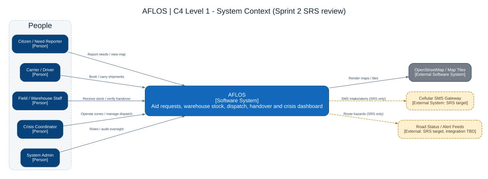
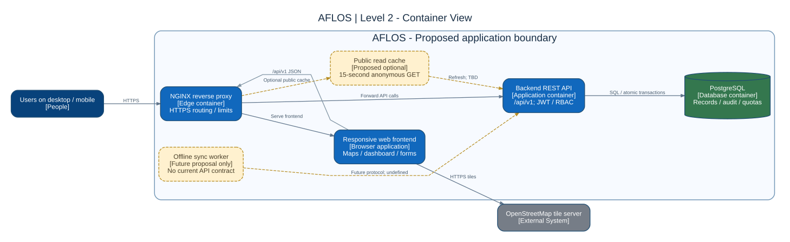
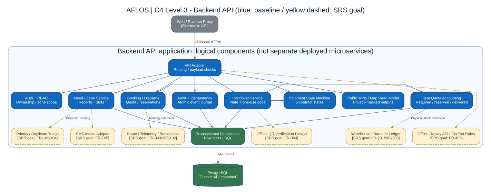

# AFLOS — Sprint 2 C4 Architecture and ADRs (SRS-Aware Review Draft)

**Issue:** [#30 — C4 Architectural Modeling](https://github.com/CoskunerBerke/AFLOS/issues/30)  
**Architects:** `@kurdoglu25`, `@akgozmirza`  
**Baseline A:** `api/openapi.yaml` — OpenAPI 3.1.0, API v0.1.0 (existing executable-interface *design contract*, not a deployed service).  
**Baseline B:** `docs/requirements/07-software-requirements-specification.md` — Sprint 2 SRS v1.0.0 in [Product Owner PR #29](https://github.com/CoskunerBerke/AFLOS/pull/29) (not necessarily merged into `develop`).  
**Status:** **Architecture design for review, not proof of implementation or full contract compatibility.**

## 1. Architectural scope and discrepancy handling

AFLOS is a disaster logistics and aid coordination system. This document models its people, application containers, logical backend components, and architecture decisions at C4 Levels 1–3. **The SRS and current OpenAPI describe materially different MVP scopes.** We therefore distinguish:

- **Baseline (blue):** behavior or interfaces directly supported by the existing OpenAPI draft, or architecture assumed for that implementation.
- **SRS extension (yellow, dashed):** behavior required in the Sprint 2 SRS but not yet supported by the existing API contract. This is **proposed architecture**, not implemented software.
- **Pending alignment:** SRS-to-API endpoint and workflow differences that must be reconciled before claiming Issue #30's full SRS **and** OpenAPI alignment criterion is satisfied.

The intended order of authority is an explicitly approved Product Owner scope decision followed by an updated, versioned OpenAPI contract and the matching C4 architecture. A new SRS file by itself does **not** silently rewrite `api/openapi.yaml`.

### 1.1 Important discrepancies (observed in submitted source documents)

| Concern | Current OpenAPI / architecture guide | Sprint 2 SRS v1.0.0 | Architectural treatment |
|---|---|---|---|
| Need intake | `POST /need-requests`, zone needs and coordinator review | `POST /needs`, scoring, duplicate detection, tracking token/PIN | Existing API as baseline; SRS triage, tracking as proposed |
| Booking and vehicle dispatch | Immediate atomic `POST /carrier-applications` creates `CONFIRMED` shipment | Dynamic vehicle/mission matching and coordinator-approved inventory reservations | Keep atomic booking contract; model matching as SRS extension until workflow is reconciled |
| Physical inventory | Need-level required/reserved/delivered quantity | Multi-tier warehouses, stock intake, barcode scans, alert thresholds | Add proposed warehouse-ledger component; do not conflate with need quota accounting |
| Handover | Field staff submit plate, one-use code and actual quantities via `POST /handover/verify` | Offline signed QR handover via `POST /shipments/{id}/deliver` | Retain current online handover; show QR as SRS extension |
| Offline | Coordinator fallback remains **online at command center** | PWA IndexedDB queue, offline sync, optional SMS ingestion | Add browser-side queue and proposed sync adapter; no false claims about working sync |
| Maps and routing | Public map/summary API, 15-second anonymous GET cache; map tile provider external | Heatmaps refreshed in <= 5 seconds, telemetry and damaged-road routing | Add SRS route/telemetry/heatmap proposals; **5-second target versus 15-second cache needs design decision** |
| Security roles | `FIELD_STAFF` and `COORDINATOR` scoped by assignment; `ADMIN` audits | `WAREHOUSE_STAFF` and broader admin/warehouse operations | Role names and access policy require explicit harmonization |

## 2. C4 Level 1 — System Context

This diagram intentionally draws **AFLOS as one system**. Citizens, carriers, field/warehouse staff, coordinators, and administrators are people who interact with it. OpenStreetMap is an existing external dependency. SMS and road/alert feeds are shown dashed because the Sprint 2 SRS requests them but current domain endpoints do not define these integrations.

Editable sources: [Graphviz DOT](diagrams/c4_level1_context.dot) and [Mermaid](diagrams/c4_level1_context.mmd). External dependencies are not claimed to be connected or deployed.

## 3. C4 Level 2 — Container Diagram

Editable sources: [Graphviz DOT](diagrams/c4_level2_containers.dot) and [Mermaid](diagrams/c4_level2_containers.mmd).

A C4 **container** means an independently running application or data store, **not** necessarily a Docker container.

| Container | Responsibility | Evidence and status |
|---|---|---|
| NGINX edge | HTTPS routing and proposed rate controls | Sprint 1 deployment target |
| Responsive web frontend | Forms, map UI and role-specific dashboard | Required by project vision; exact framework not finally approved |
| REST API | JWT/RBAC, aid zone and need endpoints, atomic booking, online handover | OpenAPI v0.1.0 design contract |
| PostgreSQL | Slot/quota, need, shipment, idempotency and audit transactions | Sprint 1 architectural target |
| Public read cache | 15-second public GET responses, never private responses | Optional delivery mechanism for existing HTTP contract |
| **PWA offline queue (SRS)** | IndexedDB and service worker buffering; idempotent replay | **Required by SRS FR-405, not defined by current API** |
| **Warehouse / triage / SMS / routing extensions (SRS)** | New application logic and/or adapters; deployment boundaries TBD | **Required by SRS FR-103–105, 201–205, 303/305, 402** |
| **Redis spatial index (SRS)** | Potential spatial lookups/caching for duplicate requests | **Proposed by SRS diagram, not current approved API infrastructure** |

**Critical offline distinction:** The current `POST /handover/fallback` lets a **connected coordinator** confirm delivery during a remote field outage; it is **not** an offline synchronization engine. To satisfy SRS FR-405, define queue schema, persistence/expiry, identity checks, retry/order, idempotency and conflict reconciliation, plus versioned replay API operations before claiming fully specified offline sync.

## 4. C4 Level 3 — Backend API Components

Editable sources: [Graphviz DOT](diagrams/c4_level3_components.dot) and [Mermaid](diagrams/c4_level3_components.mmd).

The blue components are **logical parts of the proposed backend REST API** supported by the existing interface. The yellow dashed components are **additional SRS target responsibilities**. They are **not asserted to be working services or existing endpoints**. Offline IndexedDB storage is located in the Level 2 client, not inside this backend.

| Backend component | Representative interface or requirement |
|---|---|
| API adapter / authorization | Existing REST routes and `POST /auth/token`; RBAC and ownership boundaries |
| Need/zone service | `POST /need-requests`, `POST /aid-zones`, zone needs |
| Booking/dispatch engine | `POST /carrier-applications`, standby fleet assignment |
| Item quota accounting | `requiredQuantity`, `reservedQuantity`, `deliveredQuantity`, `openDeficit` |
| Handover and lifecycle | `POST /handover/verify`, `POST /handover/fallback`, shipment status operations |
| Public dashboard | `GET /dashboard/summary`, `GET /aid-zones` |
| Audit and idempotency | `GET /admin/audit-logs`, replay-safe mutations |
| **Priority scoring + duplicate triage** | **SRS FR-103, FR-104; API additions TBD** |
| **Physical warehouse + barcode ledger** | **SRS FR-201–205; warehouse/inventory endpoints TBD** |
| **Routing, GPS telemetry and bottleneck detection** | **SRS FR-303, FR-305, FR-402; endpoints TBD** |
| **SMS intake adapter** | **SRS FR-105; SMS gateway ingress endpoint TBD** |
| **Offline QR proof + replay API** | **SRS FR-304, FR-405; payload, auth and conflict API TBD** |

### 4.1 Rules that must not be lost during reconciliation

1. Baseline booking uses an **atomic transaction**: quota capacity, overlapping plate schedule, reserved need lines, shipment creation, idempotency and audit must commit or roll back together.
2. Valid baseline shipment states are `CONFIRMED`, `IN_TRANSIT`, `DELIVERED`, `CANCELLED`, `NO_SHOW`. Rerouting is an **operation**, not a `REROUTED` state.
3. `openDeficit = max(0, requiredQuantity - reservedQuantity - deliveredQuantity)` measures **pledged need coverage**, not physical warehouse quantity.
4. Public outputs must mask PII and delivery secret codes. Authenticated reads use `Cache-Control: no-store`.
5. The SRS's offline QR design cannot silently replace the baseline plate/code flow; this requires an updated handover API and security model.

## 5. Architectural Decision Records (ADRs)

Each decision has a recorded **status**; none of these statements claims deployed implementation or unanimous team approval.

### ADR-001 — API first with reconciled SRS scope

- **Status:** Proposed, contract reconciliation required.
- **Decision:** Retain OpenAPI v0.1.0 as the *current interface baseline*. Use SRS v1.0.0 to model target extensions, without inventing the missing endpoints as existing API operations.
- **Consequence:** Back-end and C4 can be finalized together only after the Product Owner's intended MVP scope is reflected in a versioned OpenAPI revision.

### ADR-002 — PostgreSQL transactions for booking, quota and physical stock

- **Status:** Baseline design; extension design pending.
- **Decision:** Keep row-level locking for capacity and reserved needs. If warehouse stock is added, create a **separate physical stock ledger** with explicit consistency, warehouse ownership, and movement records rather than reusing `reservedQuantity` as warehouse inventory.
- **Consequence:** Prevents overbooking while avoiding incorrect mapping between pledged cargo and warehouse assets.

### ADR-003 — Responsive web and SRS PWA offline capability

- **Status:** Responsive web baseline; PWA extension requested by SRS.
- **Decision:** Design the responsive browser client behind the NGINX edge. For FR-405, add service-worker-controlled offline submissions in IndexedDB and secure replay-on-reconnection, **subject to API protocol and threat-model design**.
- **Consequence:** Requires retention, credentials/expiry, device encryption, synchronization ordering and duplicate prevention review. No claim of implemented offline support.

### ADR-004 — Public caching and updated dashboard freshness

- **Status:** Conflict pending.
- **Decision:** Honor current OpenAPI public cache headers (`max-age=15`) and `no-store` for private views **until the API/NFR contract changes**. SRS FR-401's <= 5-second refresh target needs explicit cache/streaming design and verification; a 15-second freshness guarantee does not establish a 5-second freshness guarantee.
- **Consequence:** API response TTL, monitoring, push/poll methods and any Redis choice must be agreed together.

### ADR-005 — Two different offline and delivery models

- **Status:** Baseline behavior + SRS extension, unresolved.
- **Decision:** Preserve online carrier/field plate + one-use-code verification and the **connected** coordinator fallback as baseline. Model SRS FR-304 offline signed QR proof as a distinct candidate verification protocol, together with FR-405 offline queue/replay. **Do not claim both are already contractually compatible.**
- **Consequence:** A signed QR record must be authenticated, expiry-bound, replay-safe, and mapped to a new agreed delivery confirmation API; double-delivery and delayed sync require tests.

### ADR-006 — Immutable audit and idempotency

- **Status:** Baseline contract; scope extension proposed.
- **Decision:** Keep append-only audit and mandatory `Idempotency-Key` for state mutations. Extend the same standards to SMS ingestion, physical stock, offline sync and QR handover if the new SRS features are accepted.
- **Consequence:** Avoids duplicated inventory/handover effects during retries and disconnections; API and retention/security policies need revision.

### ADR-007 — Warehouse, triage, SMS and dispatch extension boundaries

- **Status:** Proposed from SRS, not in OpenAPI v0.1.0.
- **Decision:** Model need-priority/deduplication, physical warehouse ledger, routing/telemetry, and SMS gateway as distinct **logical responsibilities**. Decide whether each is an API module or independently deployed service only after acceptance criteria, scaling constraints and endpoints are reconciled.
- **Consequence:** Avoids falsely declaring microservices and operational infrastructure based solely on a requirements document.

## 6. SRS functional-requirement traceability (Sprint 2)

This is a **design coverage map**, not a claim that the current OpenAPI implements every SRS endpoint. Requirement identifiers below come from Sprint 2 SRS v1.0.0.

| SRS IDs | Required responsibility | C4 model placement | Current OpenAPI alignment |
|---|---|---|---|
| FR-101/102 | Rapid anonymous need submission, coordinate capture / reverse geocoding | Web + Need/Zone service | **Partial:** need submission endpoint exists under a different path and schema; reverse geocoding not specified |
| FR-103/104/105/106 | Priority and duplicate scoring, SMS fallback, tracking token/PIN | Triage, SMS adapter, need service | **Gap:** new endpoints/fields/workflows needed |
| FR-201/202/203 | Warehouses, taxonomy, barcode inventory intake | Warehouse ledger, database | **Gap:** need-quota records are not the same as warehouse stock |
| FR-204 | Reservation and soft-lock | Booking + quota accounting + PostgreSQL | **Partial:** atomic need pledge exists, warehouse allocation is different |
| FR-205 | Critical stock alerts | Warehouse / alerts | **Gap:** threshold API/workflow absent |
| FR-301/302 | Payload limits, manifests, dynamic fleet matching | Dispatch/booking + carrier UI | **Partial:** vehicle capacity and standby assignment exist; manifest/algorithm absent |
| FR-303/304/305 | Damaged-road routing, offline QR, GPS telemetry | Routing, QR, client/PWA | **Gap:** new external data, cryptography and interfaces needed |
| FR-401 | Heatmap / <= 5 second view | Web dashboard, public read model | **Partial/conflict:** GET summary/aid zones and 15s HTTP cache; no streaming/heatmap API |
| FR-402 | Bottleneck detection | Routing/telemetry analytical component | **Gap:** no matching API endpoint |
| FR-403/404 | RBAC and immutable audit | Auth + audit component | **Mostly covered:** zone/role access and audit endpoint; exact SRS role naming needs mapping |
| FR-405 | IndexedDB offline queue and replay | PWA client + replay API | **Gap:** coordinator fallback is not offline sync |

**Required follow-up for full Issue #30 alignment:** An approved scope decision and updated `api/openapi.yaml` with consistent endpoint names, request/response schemas, roles, flows and nonfunctional constraints. The C4 architecture cannot honestly be certified as compatible with two contradictory contracts until that happens.

## 7. Issue #30 review checklist

- [x] C4 Level 1, 2, 3 diagrams supplied and rendered as SVG for GitHub
- [x] SRS-mandated capabilities explicitly mapped to the C4 levels
- [x] Existing OpenAPI operations identified without falsely renaming them
- [x] ADRs expanded to cover scope differences, warehouse data and offline security
- [x] Source definitions provided as Graphviz DOT and native C4 Structurizr DSL
- [ ] Confirm the MVP scope and reconcile the current OpenAPI with Sprint 2 SRS (or amend SRS)
- [ ] Validate the Structurizr DSL in a compatible renderer (official C4 notation check)
- [ ] Co-architect review of architectural assumptions; PR reviewed and approved
- [ ] Close Issue #30 **only after** acceptance criteria are met

## Appendix A — Native C4 notation source (Structurizr DSL)

The diagrams above use C4 abstraction levels, with visually explicit **baseline versus SRS extension** elements. Native C4 modeling source is provided at [diagrams/aflos_c4_workspace.dsl](diagrams/aflos_c4_workspace.dsl). The `.dsl` file is intentionally displayed as source code by GitHub; it is **not** automatically converted into a diagram there. It must be rendered/validated with a Structurizr-compatible tool before declaring formal notation validation complete. The SVGs were generated from the DOT sources, not from this DSL.

This document and these diagrams describe **architecture design**, not already deployed services. Architecture descriptions must be reconciled with versioned product/API contracts before implementation claims or final review approval.
