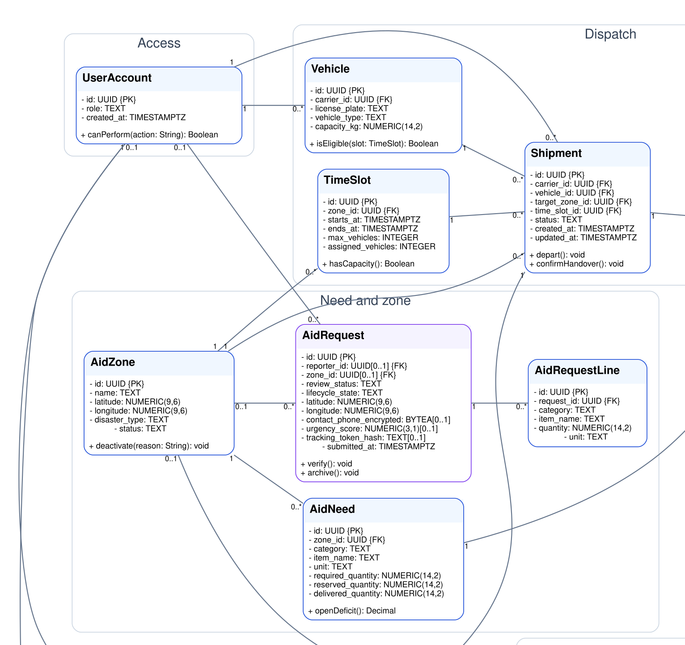
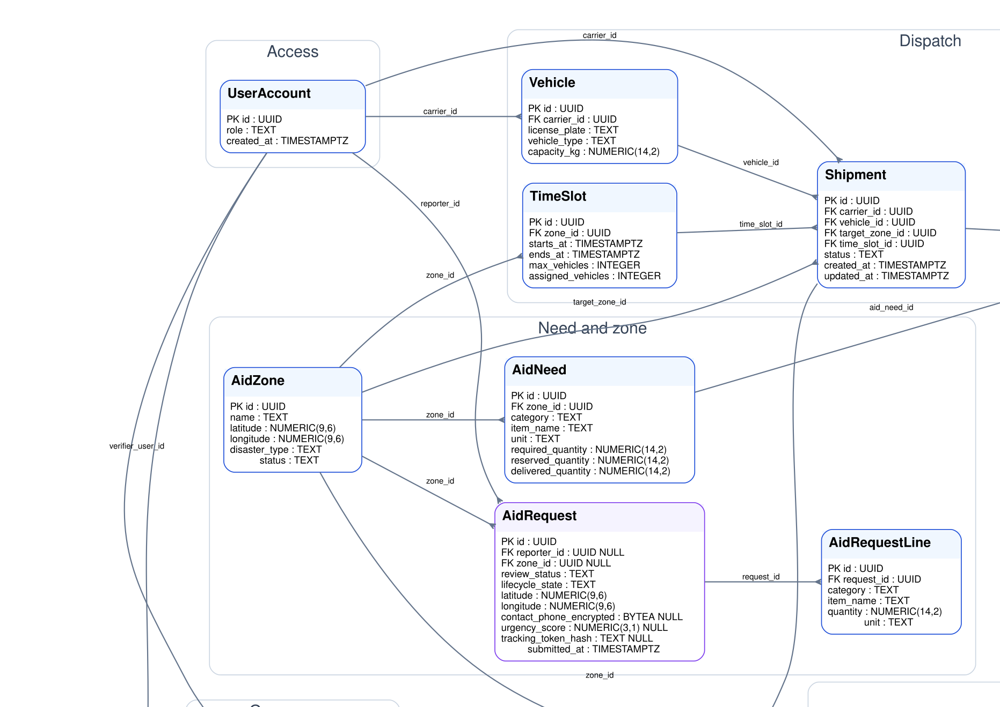
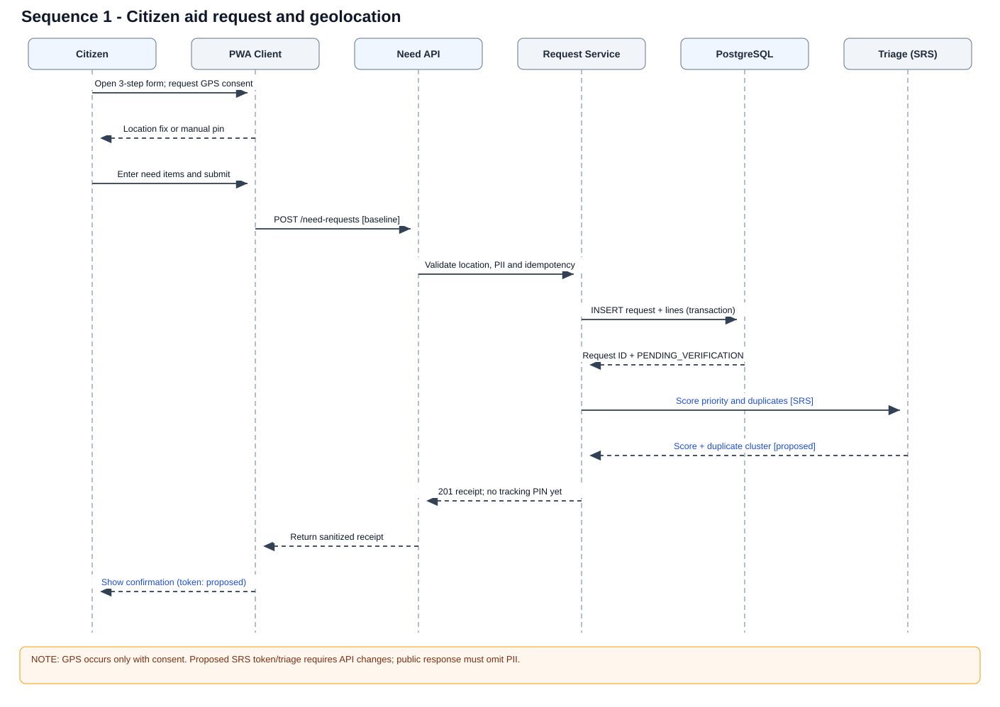
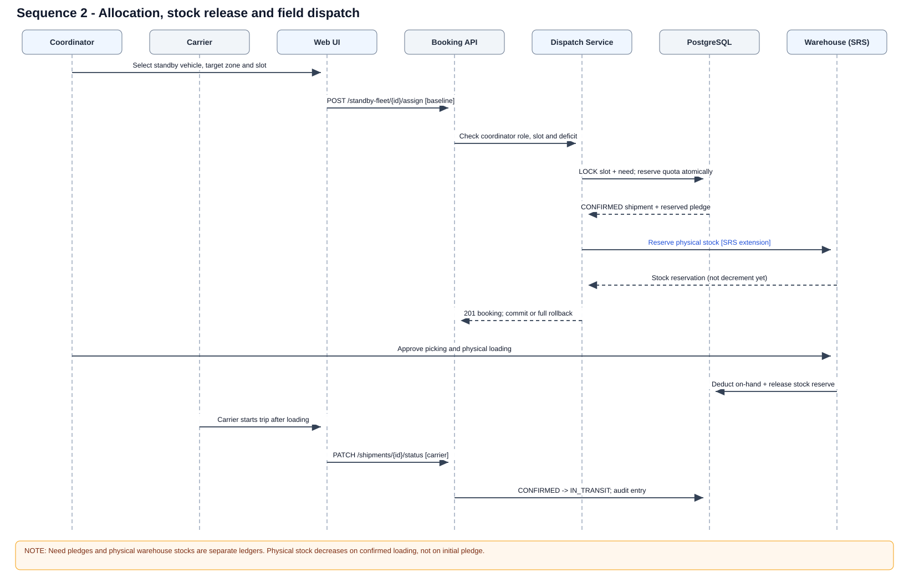
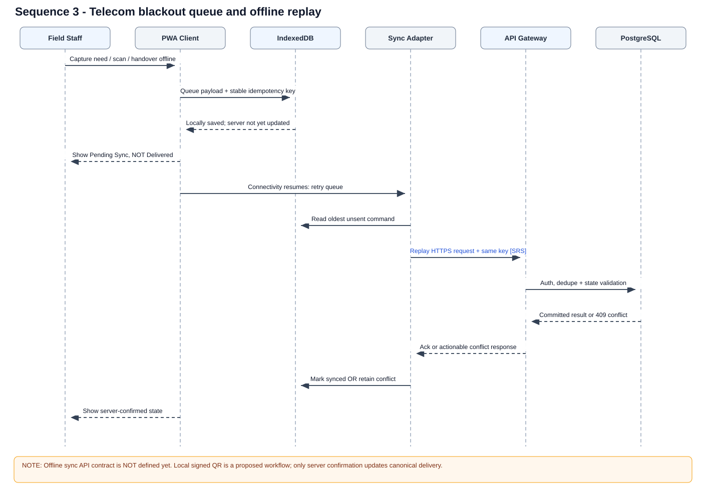
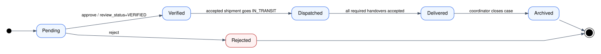

# AFLOS — UML Structural and Behavioral Architecture (Sprint 2)

**Issue:** [#31 — UML Structural and Behavioral Diagrams](https://github.com/CoskunerBerke/AFLOS/issues/31)  
**Architects:** `@kurdoglu25`, `@akgozmirza`  
**Status:** **Review draft — proposed PostgreSQL schema; not an implemented service or approved database migration.**  
**Notation:** UML 2.5-style class, interaction and state-machine views; ERD uses relational crow's-foot conventions (ERD is not itself an OMG UML diagram).

## 1. Source baselines and modeling rules

- Current interface baseline: [`api/openapi.yaml`](../../api/openapi.yaml), OpenAPI 3.1 draft; core need requests, zones, slots, atomic carrier booking, shipment lifecycle, handover and audit operations.
- New Sprint 2 SRS: [`07-software-requirements-specification.md`](../requirements/07-software-requirements-specification.md) in Product Owner [PR #29](https://github.com/CoskunerBerke/AFLOS/pull/29); describes additional triage, warehouse, SMS, offline QR and sync functionality.
- Sprint 2 backlog: [`06-refined-product-backlog.md`](../requirements/06-refined-product-backlog.md); classifies warehouse/SMS/QR capabilities as **Should Have**, while core booking, aid intake and audits are **Must Have**.
- NFR: [`08-non-functional-requirements.md`](../requirements/08-non-functional-requirements.md); particularly NFR-PE-03, RA-03, SE-03, MP-01.
- UI flows: [`09-user-flows-and-ui-spec.md`](../requirements/09-user-flows-and-ui-spec.md); citizen, warehouse, carrier, coordinator.
- Existing architecture: [`c4_model.md`](c4_model.md), C4 levels 1–3 and proposed SRS extensions.

**Conflict-management rule:** The Product Owner's Sprint 2 documents and OpenAPI v0.1.0 differ. The diagrams distinguish current API behavior from **proposed SRS extensions**. Never interpret this submission as proof that an API or PostgreSQL schema has been implemented. In particular, `/need-requests` exists while `/needs` is only specified in SRS; `/carrier-applications` performs direct atomic booking in OpenAPI, while SRS also describes coordinator-controlled warehouse allocation.

**Model consistency:** All 15 domain entities and their column names/types are declared in one model and carried *identically* into the Class Diagram, ERD and companion [`uml_schema_proposal.sql`](uml_schema_proposal.sql). Public UML methods are not database columns. The local IndexedDB queue is a client-side store and is intentionally **not** misrepresented as a PostgreSQL table.

### Legend

- **Blue:** baseline domain entity or relationship needed for the OpenAPI-driven model.
- **Amber:** SRS-only entity or behavior (warehouse/physical stock).
- **Purple:** combined baseline and SRS fields, awaiting reconciliation.
- `PK` primary key; `FK` foreign key; `0..*` optional many; `1` one; `0..1` optional one.

## 2. UML Class Diagram — domain structure and behavior

Editable UML source: [`uml_class.puml`](diagrams/uml_class.puml) · Graphviz render source: [`uml_class.dot`](diagrams/uml_class.dot).

**Responsibilities:** `AidRequest` captures citizen submissions, and `AidRequestLine` holds itemized demand; `AidZone` owns `AidNeed` target quantities and `TimeSlot` reservations. `Shipment` and `ShipmentItem` represent carrier bookings and actual handover reconciliation. The proposed `Warehouse`/`StockItem`/`StockReservation` model holds **physical stock**, distinct from pledged aid need quotas. `HandoverProof` records verification *metadata* but never stores raw secret codes. `AuditEntry` and `IdempotencyRecord` support governance and replay safety.

The diagram lists private attributes (`-`) and public domain operations (`+`); methods represent **proposed responsibilities**, not implemented code.

## 3. Entity-Relationship Diagram — PostgreSQL logical schema

Editable ERD source: [`uml_erd.dot`](diagrams/uml_erd.dot). Companion candidate PostgreSQL DDL: [`uml_schema_proposal.sql`](uml_schema_proposal.sql).

### 3.1 Schema consistency and key rules

- **100% *internal artifact* column consistency:** every `Class.attribute` in the diagram corresponds to exactly one `table.column` in the SQL and ERD. SQL keys, FKs, nullable constraints and database types use the same canonical definition.
- `aid_request.review_status`: current OpenAPI verification statuses `PENDING_VERIFICATION`, `VERIFIED`, `REJECTED`. `aid_request.lifecycle_state`: **proposed separate operational workflow projection**, not an existing OpenAPI field.
- `shipment.status` remains strictly `CONFIRMED`, `IN_TRANSIT`, `DELIVERED`, `CANCELLED`, `NO_SHOW`. Do **not** copy `AidRequest` status labels into shipment state.
- `aid_need.reserved_quantity` is *pledged need coverage*. `stock_item.on_hand_quantity` and `stock_item.reserved_quantity` are physical warehouse stock. They are not interchangeable.
- Time-slot and need allocations require atomic transactions with row locks to prevent `409` race-condition violations; field handover quantities are reconciled on the **server** once. Public PII is redacted; no raw delivery code should be stored in audit records.
- `IdempotencyRecord` deduplicates HTTP replay by actor scope, method, path and idempotency key; the SRS offline client queue is stored in **IndexedDB**, not in this PostgreSQL schema.
- This SQL is a proposed **design artifact**. No actual migrations have been supplied; **100% alignment with an implemented production schema cannot yet be claimed**. It must be reviewed with the DevOps/database owner.

## 4. Behavioral Sequence 1 — citizen aid request and GPS reporting

Editable UML: [`uml_sequence_citizen_request.puml`](diagrams/uml_sequence_citizen_request.puml).

**Source mapping:** SRS FR-101/102/103/104/106, UI Flow PER-01, backlog US-01/02, existing `POST /need-requests`. Citizen location consent/manual pin comes before submission. `PENDING_VERIFICATION` is the persisted baseline review status. Automated scoring/duplicate clustering and tracking PIN are **SRS extensions**, not already supported OpenAPI responses.

## 5. Behavioral Sequence 2 — aid allocation, physical stock and field dispatch

Editable UML: [`uml_sequence_alloc_dispatch.puml`](diagrams/uml_sequence_alloc_dispatch.puml).

**Source mapping:** SRS FR-204, FR-301/302, FR-201/203, backlog US-04/05/06/07. This sequence shows the existing atomic booking rule (`POST /standby-fleet/{standbyId}/assign` / `CONFIRMED`) alongside proposed warehouse physical stock reservations. `StockItem.on_hand_quantity` decreases only upon confirmed physical release/loading; booking alone holds reserved quantities. Departure uses `PATCH /shipments/{shipmentId}/status`, which changes `CONFIRMED` to `IN_TRANSIT` without reserving twice. For coordinator-originated dispatch, the specified route is `POST /standby-fleet/{standbyId}/assign` (COORDINATOR); self-service `POST /carrier-applications` is CARRIER-only. The subsequent departure PATCH is performed by the carrier.

## 6. Behavioral Sequence 3 — telecommunication blackout and offline queue replay

Editable UML: [`uml_sequence_offline_sync.puml`](diagrams/uml_sequence_offline_sync.puml).

**Source mapping:** SRS FR-304/405, NFR-RA-03 (500 queued actions and <= 5 second sync target after reconnection), NFR-SE-03, UI Flow PER-01/02 and backlog US-08/09. An offline client places a command in IndexedDB with a stable replay key; network restoration triggers authenticated retries; a 409 conflict must remain available for safe manual reconciliation. A local QR/receipt is not canonical server delivery until successful sync acknowledgement. **Offline sync and signed QR payload endpoints are new SRS designs, not current OpenAPI v0.1.0 behavior.** The current connected-coordinator `/handover/fallback` is not offline sync.

## 7. Aid Request State Machine (distinct from Shipment lifecycle)

Editable UML: [`uml_aid_request_state.puml`](diagrams/uml_aid_request_state.puml) · Graphviz source: [`uml_aid_request_state.dot`](diagrams/uml_aid_request_state.dot).

Required path: **Pending → Verified → Dispatched → Delivered → Archived**. Exceptional rejection path also shown. Operational transitions correspond to coordinator verification, shipment movement, accepted delivery events and archival. These are conceptual *AidRequest lifecycle* states, **not** the shipped OpenAPI `NeedRequest.status` enumeration; the proposed `lifecycle_state` column is included explicitly in both class and ERD/SQL to document this new requirement. `Delivered` may be entered only after the authoritative backend acknowledges sufficient fulfillment, never solely from offline device input. Shipment and request states must not be conflated.

## 8. Traceability and acceptance checks

| Issue #31 deliverable | Evidence | Acceptance notes |
|---|---|---|
| Class Diagram | `uml_class.svg` and `.puml` | 15 entity classes with visibility, attributes, public operations, FK relationships and multiplicity notation |
| PostgreSQL ERD | `uml_erd.svg` and `.dot` | 15 tables, typed PK/FK, companion SQL DDL and CHECK/UNIQUE constraints |
| Sequence 1 | `uml_sequence_citizen_request.svg` and `.puml` | GPS capture, request persistence, proposed triage/confirmation |
| Sequence 2 | `uml_sequence_alloc_dispatch.svg` and `.puml` | Atomic booking, physical stock reservation/release, actual dispatch |
| Sequence 3 | `uml_sequence_offline_sync.svg` and `.puml` | Offline queue/replay, stable idempotency, safe server confirmation |
| State Machine | `uml_aid_request_state.svg` and `.puml` | Required 5-stage path plus optional rejection; separate from shipment states |

### Known limitations and review items

- [x] Diagram image files generated for GitHub (no Mermaid rendering dependency).
- [x] Class, ERD and DDL generated from one attribute definition, preventing naming drift.
- [x] Current OpenAPI baseline and unimplemented SRS extensions explicitly distinguished.
- [ ] Confirm `uml_schema_proposal.sql` with DevOps against any implemented PostgreSQL migration.
- [ ] Product Owner to reconcile SRS/backlog with OpenAPI endpoints and request states.
- [ ] Peer review of UML multiplicities, transaction boundaries, offline threat model and proposed DDL.
- [ ] Approved Pull Request required before Issue #31 can be closed.

**Note on standards:** UML class/sequence/state figures apply common OMG UML 2.5.1 conventions; ERD is a relational database model, not an OMG UML diagram. Editable PlantUML sources are provided but require rendering/semantic peer review before claiming fully certified OMG compliance. See [OMG UML 2.5.1](https://www.omg.org/spec/UML/2.5.1) for formal definitions.
