# SENG 321 – Sprint 1 Deliverable 2: System Vision and Boundary

**Project Title:** AFLOS – Disaster Logistics & Aid Coordination System  
**Course:** SENG 321 (BM 321) – Software Engineering Project  
**Sprint:** Sprint 1 – Project Foundation & Team Operating Model  
**Role / Document Owner:** Product Owner and Requirements Engineer – **Kaan Kılınç (230204047)** (`@kaanklnc`)  
**Repository:** [https://github.com/CoskunerBerke/AFLOS](https://github.com/CoskunerBerke/AFLOS)  

---

## 1. System Vision Statement

> **For** disaster response coordinators (AFAD, municipalities, and authorized relief NGOs), volunteer vehicle and fleet owners, on-site distribution volunteers, and disaster-affected citizens **who** require deterministic, transparent, and bottleneck-free coordination of emergency relief supplies across Turkey, **AFLOS (Disaster Logistics & Aid Coordination System)** is a **map-centric, API-first disaster logistics command and coordination platform** **that** delivers real-time national KPI visibility, categorized line-item need tracking (*water, biscuits/dry food, blankets, tents, winter clothing, medical, hygiene*), quota-enforced arrival time slots, license-plate-verified dispatch with two-factor cryptographic handover, and offline-resilient operational continuity. **Unlike** ad-hoc social media broadcasts, unverified spreadsheets, or closed-circuit government portals that exclude civilian logistics actors and cause road gridlock at distribution points, **our product** prevents drop-off congestion through mathematical slot quotas (`409 Conflict`), enforces two-factor delivery verification without costly SMS gateways, supports dual-mode vehicle dispatch (carrier self-application and coordinator fleet assignment), and ensures uninterrupted operations through institutional coordinator workflows even during total telecommunication blackouts in the disaster epicenter.

---

## 2. Target Users and Operational Roles

The AFLOS platform enforces strict **Role-Based Access Control (RBAC)** across five distinct user classes:

### 2.1 Public Visitor / Regional Need Reporter (`PUBLIC` / `REPORTER`)
- **Profile:** Citizens residing in affected areas, village heads (*Muhtars*), or out-of-province relatives submitting proxy reports on behalf of impacted communities.
- **Capabilities & Permissions:**
  - View the live, transparent **Interactive Turkey Disaster Map** and public **KPI Dashboard Cards** (*Active Aid Zones, Vehicles In-Transit, Delivered Shipments, Category Fulfillment Rates*).
  - Filter map pins by **Disaster Type** (`EARTHQUAKE`, `FLOOD`, `WILDFIRE`, `CONFLICT_HUMANITARIAN`, `LANDSLIDE_AVALANCHE`) and **Aid Item Category**.
  - Submit **Regional Aid Need Requests** by selecting map coordinates, disaster type, and entering specific line items (*Category + Item Name + Quantity + Unit*) along with contact details.
  - *Data Privacy Restriction:* Reporter identities and phone numbers are quarantined and stripped from public views (strictly masked under KVKK compliance).

### 2.2 Carrier / Vehicle Owner (`CARRIER`)
- **Profile:** Independent truck drivers, commercial logistics companies, and civilian vehicle owners volunteering transportation capacity.
- **Capabilities & Permissions:**
  - Register vehicles with **License Plate (`34 ABC 123`)**, vehicle type (`TRUCK_TIR`, `LORRY`, `VAN`, `CAR`), and load capacity.
  - Apply in **Dual Modes**:
    - **Mode A (Ready Cargo Dispatch):** Select an active Aid Zone and an open **Time Slot** (`08:00–12:00`, `12:00–16:00`), pledge specific item quantities within remaining need limits (capped to prevent over-pledging), and submit for approval.
    - **Mode B (Standby Fleet Pool):** Register an empty vehicle and location into the standby pool for direct coordinator route assignment.
  - Transition approved shipments to **`IN_TRANSIT`** upon physical departure.
  - Access the tamper-proof **Shipment Verification Code (e.g., `AFL-7492`)** and dynamic QR code generated for on-site two-factor delivery matching.
  - Cancel reservations within the allowable grace period (up to 2 hours before the scheduled time slot).

### 2.3 Field Staff / On-Site Distribution Volunteer (`FIELD_STAFF`)
- **Profile:** Vetted volunteers and civil servants operating physically at designated disaster drop-off and aid distribution centers.
- **Capabilities & Permissions:**
  - Submit shift and location availability via the **Field Volunteer Application Portal**.
  - Once verified, gain scoped access strictly limited to their assigned **Aid Zone (`zoneId`)**; access to unassigned zones is blocked (`HTTP 403 Forbidden`).
  - View real-time lists of scheduled incoming vehicles for their assigned time slots.
  - Perform **Two-Factor Handover Verification**: Inspect arriving vehicles by matching the physical **License Plate** and the driver's **Cryptographic Verification Code / QR**.
  - Input the **Actual Delivered Quantity (`actualDeliveredQuantity`)** to account for partial delivery or surplus before marking a shipment as **`DELIVERED`**.
  - *Device Failure Fallback:* Execute manual driver's license/TC-ID identity verification in coordination with central coordinators if a driver's smartphone battery is depleted.

### 2.4 Disaster Coordinator (`COORDINATOR`)
- **Profile:** Authorized operational leads representing government disaster agencies (AFAD), municipal crisis desks, and vetted humanitarian NGOs.
- **Capabilities & Permissions:**
  - **Institutional Direct Entry:** Create and publish active **Aid Zones** directly on the Turkey map based on institutional field radio/satellite reports, completely independent of citizen web submissions.
  - Configure operational **Time Slots** (`startsAt`, `endsAt`) and set deterministic **Vehicle Quotas** (`maxVehicles`, e.g., 5 trucks per 4-hour window) and **Allowed Vehicle Types** (`allowedVehicleTypes`).
  - Define, update, and manage line-item item needs (*Category, Custom Item Name, Required Quantity, Unit*).
  - Review, verify, or reject public **Need Requests** (`PENDING_VERIFICATION`), **Carrier Applications**, and **Field Volunteer Applications**.
  - Directly assign available empty vehicles from the standby pool to urgent routes.
  - **Emergency Dynamic Re-Routing (`REROUTED`):** If a drop-off zone becomes hazardous and is deactivated (`DEACTIVATED`), re-route all incoming `IN_TRANSIT` vehicles to the nearest safe alternate zone.
  - **Coordinator Fallback Handover:** Execute central `DELIVERED` status updates when on-site field staff experience complete telecommunication blackouts.

### 2.5 System Administrator (`ADMIN`)
- **Profile:** System governance and security engineers managing core system infrastructure.
- **Capabilities & Permissions:**
  - Provision, manage, and revoke `COORDINATOR` and administrative credentials.
  - Configure system-wide Master Disaster Types, Master Aid Categories, and Standard Measurement Units.
  - Query, inspect, and export immutable, tamper-evident **Audit Logs** for operational governance, transparency, and post-disaster analysis.

---

## 3. System Boundary Specification (In-Scope vs. Out-of-Scope)

```
+----------------------------------------------------------------------------------------------------+
|                                    AFLOS SOFTWARE BOUNDARY                                         |
|                                                                                                    |
|   +--------------------------------------------------------------------------------------------+   |
|   | 1. National Impact & Situational Awareness                                                  |   |
|   |    - Real-time aggregated KPI counters (Active Zones, In-Transit Vehicles, Delivered Shipments)|   |
|   |    - Category-level progress tracking (Required vs. In-Transit vs. Delivered)                  |   |
|   |    - Leaflet/OSM geo-coordinate mapping with multi-filter queries                             |   |
|   +--------------------------------------------------------------------------------------------+   |
|   | 2. Need & Inventory Quota Management                                                       |   |
|   |    - Multi-disaster categorization (Earthquake, Flood, Wildfire, Conflict, Landslide)         |   |
|   |    - 3-tier item model: Category + Manual Item Name + Quantity + Unit                         |   |
|   |    - Over-pledging protection cap (limiting carrier pledge to open deficit)                   |   |
|   +--------------------------------------------------------------------------------------------+   |
|   | 3. Scheduling, Vehicle Dispatch & Conflict Engine                                         |   |
|   |    - Time-slot interval quota enforcement (maxVehicles per window)                            |   |
|   |    - Road compatibility validation (allowedVehicleTypes per zone)                              |   |
|   |    - Atomic conflict detection (HTTP 409 Conflict on slot overcapacity or plate overlap)       |   |
|   |    - Dual dispatch: Carrier self-scheduling and Coordinator fleet assignment                   |   |
|   +--------------------------------------------------------------------------------------------+   |
|   | 4. Verification, Security & Handover Engine                                                |   |
|   |    - 4-layer fake report quarantine and verification workflow                                 |   |
|   |    - Zero-cost 2FA handover: License Plate + Cryptographic Code / Dynamic QR                  |   |
|   |    - Actual delivered quantity reconciliation (handling partial deliveries)                    |   |
|   |    - Zone-scoped RBAC authorization enforcement (HTTP 403 Forbidden on boundary violations)   |   |
|   |    - Automatic no-show rollback and emergency zone evacuation re-routing                      |   |
|   |    - Coordinator central offline fallback delivery confirmation                                |   |
|   |    - API-level rate limiting (HTTP 429) and mathematical TC-ID checksum validation             |   |
|   |    - Immutable audit trail logging for all lifecycle transitions                               |   |
|   +--------------------------------------------------------------------------------------------+   |
|                                                                                                    |
+----------------------------------------------------------------------------------------------------+
                                      |                     |
                                      | DEFERRED / OUTSIDE  |
                                      v                     v
+----------------------------------------------------------------------------------------------------+
|                                 OUT-OF-SCOPE / EXTERNAL CONCERNS                                   |
|                                                                                                    |
|   - Physical GPS / IoT Transponders (Shipment states are driven by authenticated role transitions)  |
|   - Monetary Donations & Payment Gateways (Only physical aid and transport logistics are handled) |
|   - Multi-Stop Drop-off Routes / Milk Runs (MVP enforces single-origin to single-destination)     |
|   - Turn-by-Turn Navigation & Fuel/Maintenance ERP                                                 |
|   - Warehouse Barcode / RFID Hardware Scanning Equipment                                           |
|   - Direct Integration with Classified Government Intranets (MERNİS / Internal Police Systems)    |
|   - Native Mobile OS Compilation (Responsive web application accessible via mobile browsers)       |
+----------------------------------------------------------------------------------------------------+
```

---

## 4. System Context and External Interactions

### 4.1 System Context Diagram (Mermaid)

```mermaid
flowchart TD
    subgraph External_Actors ["Human Operational Actors"]
        Reporter["Citizen / Local Rep\n(Need Reporter)"]
        Carrier["Carrier / Vehicle Owner\n(Truck / Fleet Operator)"]
        FieldStaff["Field Staff / Volunteer\n(On-Site Verification)"]
        Coordinator["Disaster Coordinator\n(AFAD / Municipality / NGO)"]
        Admin["System Administrator\n(Platform Governance)"]
    end

    subgraph AFLOS_Core ["AFLOS Platform Boundary"]
        CoreAPI["AFLOS Core Services\n(REST API & Business Rules Engine)"]
        DB[(Transactional Relational Database\n& Audit Store)]
        CoreAPI <--> DB
    end

    subgraph External_Systems ["External Services & Dependencies"]
        MapProvider["External Map Provider\n(OpenStreetMap / Tile Server)"]
        AuthModule["Identity & Authentication Module\n(JWT & TC-Checksum Validation)"]
        NotificationStub["Notification Service\n(Email / Local Alert Stub)"]
    end

    %% User Interactions
    Reporter -->|"1. Submits need request (coordinates, items, contact)"| CoreAPI
    CoreAPI -->|"2. Serves live public map & KPI counters"| Reporter

    Carrier -->|"3. Registers plate & applies for time slot / standby pool"| CoreAPI
    Carrier -->|"4. Marks departure (IN_TRANSIT) & views verification code"| CoreAPI

    FieldStaff -->|"5. Applies for shift at specific zone"| CoreAPI
    FieldStaff -->|"6. Submits 2FA handover: Plate + Code + Actual Quantities"| CoreAPI

    Coordinator -->|"7. Opens aid zones, configures slots & enters needs"| CoreAPI
    Coordinator -->|"8. Approves/rejects applications & assigns standby fleet"| CoreAPI
    Coordinator -->|"9. Executes offline fallback handover & emergency rerouting"| CoreAPI

    Admin -->|"10. Provisions roles, configures master categories & audits logs"| CoreAPI

    %% External System Interactions
    CoreAPI -->|"11. Requests geocoding & map tiles"| MapProvider
    MapProvider -->|"12. Returns map tiles & geographic boundaries"| CoreAPI

    CoreAPI -->|"13. Resolves credentials & generates role tokens"| AuthModule
    AuthModule -->|"14. Returns JWT with role claims & zone scopes"| CoreAPI

    CoreAPI -->|"15. Dispatches assignment & approval status alerts"| NotificationStub
```



### 4.2 Context Interaction Matrix

| Interaction ID | Initiator | Target | Data / Payload Exchanged | Purpose, Protocol & Security |
|---|---|---|---|---|
| **INT-01** | `REPORTER` | AFLOS | Coordinates, Disaster Type, Requested Items, Reporter Contact. | Public Need Submission; enters `PENDING_VERIFICATION` queue; PII masked from public API. |
| **INT-02** | AFLOS | `PUBLIC` | Aggregated KPI counts, active zone pins, remaining category deficits. | Real-time situational awareness; public read-only query; 15-second static caching. |
| **INT-03** | `CARRIER` | AFLOS | License plate, vehicle type, capacity, chosen zone, slot ID, cargo manifest. | Dispatch Application; authenticated via JWT; validated against slot quota (`409 Conflict`). |
| **INT-04** | `CARRIER` | AFLOS | Shipment ID, status transition (`IN_TRANSIT`). | Departure announcement; transitions shipment; increments national `inTransitQuantity`. |
| **INT-05** | `FIELD_STAFF` | AFLOS | Volunteer shift application (zone ID, shift start/end, phone). | Shift Onboarding; requires Coordinator verification before granting zone access. |
| **INT-06** | `FIELD_STAFF` | AFLOS | Shipment ID, License Plate, Verification Code, `actualDeliveredQuantity`. | Physical Handover; scoped to user's `zoneId` (`403 Forbidden` if mismatched); deducts remaining needs. |
| **INT-07** | `COORDINATOR` | AFLOS | Zone coordinates, disaster type, time-slot intervals, vehicle quotas, item quotas. | Zone & Need Management; trusted operational role; enables direct institutional zone creation. |
| **INT-08** | `COORDINATOR` | AFLOS | Application ID, verification/rejection decision, or standby vehicle assignment ID. | Application & Fleet Dispatch; verifies pending need reports and field staff, or assigns standby fleet trucks. |
| **INT-09** | `COORDINATOR` | AFLOS | Shipment ID, fallback reason, or deactivated zone ID + target alternate zone ID. | Fallback Handover & Emergency Re-Routing; overrides field connectivity outages or hazardous zones. |
| **INT-10** | `ADMIN` | AFLOS | Role assignments, disaster types, aid categories, measurement units, audit queries. | Platform Governance & Audit; strictly restricted to `ADMIN` role token. |
| **INT-11 / 12** | AFLOS | Map Provider | Bounding box coordinates, zoom levels, tile requests. | Cartographic Rendering; standard HTTPS REST / Leaflet tile requests to OpenStreetMap. |
| **INT-13 / 14** | AFLOS | Auth Module | Username/password, mathematical TC-ID string, JWT payload. | Authentication & RBAC; stateless JWT containing `sub`, `role`, and `assignedZoneId`. |
| **INT-15** | AFLOS | Notification | Recipient address, assignment details, verification code. | Operational Alerting; decoupled via adapter interface with local testing stubs. |

---

## 5. System Constraints and Design Assumptions

### 5.1 Technical and Architectural Constraints
1. **API-First Governance:** In accordance with SENG 321 Week 3 principles, the backend implementation and frontend interfaces must strictly conform to the OpenAPI 3.1.0 specification defined in `api/openapi.yaml`. No undocumented endpoints or parameter deviations are permitted.
2. **Single-Command Docker Deployment:** The complete solution (PostgreSQL database, backend REST API, frontend web application, and NGINX reverse proxy) must initialize deterministically with one command: `docker-compose up`.
3. **Automated CI/CD & Test Coverage:** Continuous integration pipelines configured in GitHub Actions must execute on all push and pull-request events, requiring a minimum of **50% unit-test coverage** and zero critical static analysis defects before integration into `develop`.
4. **Data Integrity & Concurrency Control:** Time-slot capacity allocations (`assignedVehicles < maxVehicles`) and need inventory deductions must execute within atomic database transactions with row-level locking to prevent race conditions during simultaneous bookings.
5. **DDoS & Flash Crowd Resilience:** Public read endpoints (`/dashboard/summary`, `/aid-zones`) must utilize reverse-proxy rate limiting (`HTTP 429 Too Many Requests`) and 15-second cache headers to withstand catastrophic traffic surges during emergencies.

### 5.2 Regulatory and Operational Assumptions
1. **Institutional Communication Continuity:** If telecommunication fails in the disaster zone, official disaster response agencies communicate field reports to Coordinators in command centers via satellite, military, or radio networks.
2. **Legal Privacy Compliance (KVKK / GDPR):** Citizen personal data is classified as sensitive; all PII is masked from public responses, restricted to authorized Coordinators, and stored encrypted/hashed at rest in the database.
3. **Deterministic Single-Stop Routing:** To ensure verifiable mathematical modeling of time-slot quotas, each shipment assignment is bounded to a single source and a single destination drop-off point in Release 1.
