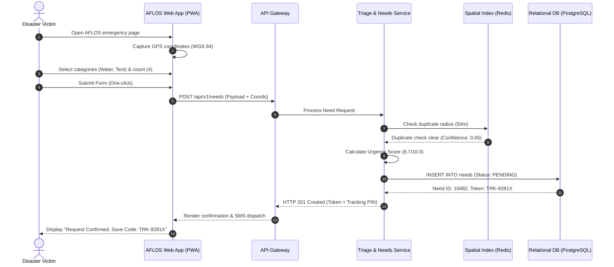
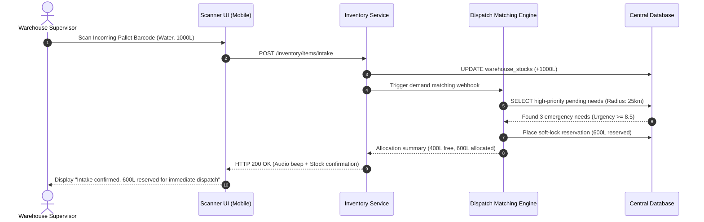
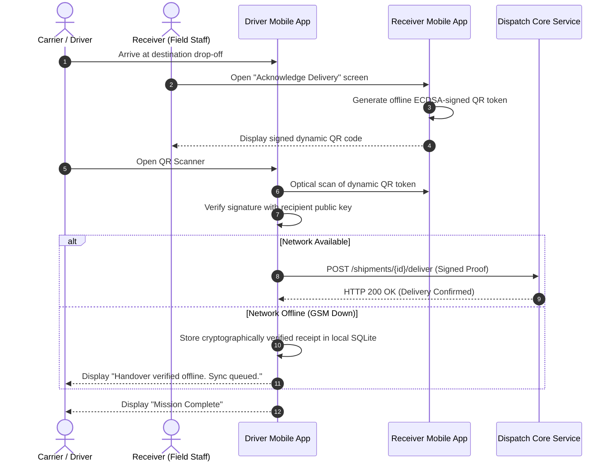

# SENG 321 — Sprint 2 Deliverable 01: Detailed Software Requirements Specification (SRS)

**Project Title:** AFLOS — Disaster Logistics & Aid Coordination System  
**Course:** SENG 321 (BM 321) — Software Engineering Project, Fall 2026  
**Sprint:** Sprint 2 — Requirements Engineering, UI/UX Prototyping & Software Architecture  
**Document Standard:** IEEE Std 830-1998 / ISO/IEC/IEEE 29148:2018 Systems and Software Engineering — Requirements Engineering  
**Role / Document Author:** Product Owner & Requirements Engineer — **Kaan Kılınç (230204047)** ([`@kaanklnc`](https://github.com/kaanklnc))  
**Repository:** [https://github.com/CoskunerBerke/AFLOS](https://github.com/CoskunerBerke/AFLOS)  
**Document Version:** 1.0.0 (Release 1 Baseline)  
**Status:** Approved for Architectural Modeling & Prototyping  

---

## Executive Summary

This document specifies the official Software Requirements Specification (SRS) for **AFLOS** (Disaster Logistics & Aid Coordination System). AFLOS is a mission-critical, fault-tolerant digital platform designed to coordinate emergency humanitarian aid, warehouse inventory, volunteer carriers, and disaster victim demands during sudden-onset natural catastrophes (such as major earthquakes, flash floods, and wildfires).

Following **ISO/IEC/IEEE 29148:2018** guidelines, this specification transitions the high-level Agile user stories formulated in Sprint 1 into unambiguous, verifiable, and prioritized functional requirement statements (`The system SHALL...`), accompanied by architectural rationales, verification methods, comprehensive use case specifications, and a full Requirements Traceability Matrix (RTM).

---

## 1. Introduction

### 1.1 Purpose
The purpose of this document is to establish a rigorous, contractual baseline of functional software requirements for the AFLOS engineering team (Systems Architects, Frontend/Backend Developers, DevOps Engineers, and Quality Assurance Specialists). It governs the architectural decomposition (C4 model, UML class/sequence diagrams) and the subsequent Sprint 3/4 implementation phases.

### 1.2 Project Scope
AFLOS Release 1 (Minimum Viable Platform - MVP) provides:
1. **Citizen Need Intake & Automated Triage:** Multi-channel reporting of humanitarian aid needs with geospatial pinning, priority scoring, and duplicate request aggregation.
2. **Field Warehouse & Inventory Management:** Real-time stock level ledger across central and field hubs, automated reservation against verified demand, and donation provenance tracking.
3. **Last-Mile Dispatch & Carrier Tracking:** Dynamic vehicle allocation, delivery manifests, route optimization, and cryptographic QR-code verified handover proof.
4. **Crisis Command Dashboard & Offline Fallback:** Situational awareness GIS heatmap, bottleneck alerts, offline-first local queueing, and fallback SMS gateway triage for telecommunication blackout environments.

*Out of Scope for Release 1:* Direct inter-bank monetary donation processing, long-term post-disaster reconstruction financing, autonomous drone flight controller firmware integration, and international customs clearance systems.

### 1.3 Definitions, Acronyms, and Abbreviations

| Acronym / Term | Definition |
|---|---|
| **AFAD** | Disaster and Emergency Management Authority (Afet ve Acil Durum Yönetimi Başkanlığı) |
| **AFLOS** | Automated/Adaptive Field Logistics & Aid Coordination Operating System |
| **DoD** | Definition of Done (Quality checklist before an increment is accepted) |
| **DoR** | Definition of Ready (Criteria before a backlog item enters development) |
| **GIS** | Geographic Information System (WGS 84 coordinate mapping) |
| **GSM** | Global System for Mobile Communications (Cellular telecommunications) |
| **JWT** | JSON Web Token (RFC 7519 secure stateless authentication token) |
| **NFR** | Non-Functional Requirement (Quality attributes, performance, security) |
| **PII** | Personally Identifiable Information (Governed under KVKK / GDPR) |
| **QR Code** | Quick Response Matrix Barcode (ISO/IEC 18004 for contactless delivery verification) |
| **RBAC** | Role-Based Access Control (System permission assignment per operational persona) |
| **RTM** | Requirements Traceability Matrix |
| **SMS** | Short Message Service (Telecommunication blackout fallback channel) |
| **SRS** | Software Requirements Specification |
| **TPS** | Transactions Per Second |
| **Triage** | The systematic prioritization of emergency aid requests based on urgency and medical vulnerability |

### 1.4 References
1. IEEE Std 830-1998: *IEEE Recommended Practice for Software Requirements Specifications*.
2. ISO/IEC/IEEE 29148:2018: *Systems and software engineering — Life cycle processes — Requirements engineering*.
3. ISO/IEC 25010:2011: *Systems and software engineering — Systems and software Quality Requirements and Evaluation (SQuaRE)*.
4. AFLOS Deliverable 01: *Project Proposal & Problem Statement* (`docs/requirements/01-project-proposal.md`).
5. AFLOS Deliverable 02: *System Vision & Boundary Specification* (`docs/requirements/02-system-vision-and-boundary.md`).
6. AFLOS Deliverable 03: *OpenAPI 3.1.0 Contract Draft* (`api/openapi.yaml`).
7. AFLOS Deliverable 06: *Initial Product Backlog & Prioritized User Stories* (`docs/requirements/06-initial-product-backlog.md`).

---

## 2. Overall Description

### 2.1 Product Perspective & Context
AFLOS operates as a cloud-native, distributed system accessible via responsive web (React/Next.js), progressive web application (PWA) with offline capabilities, and RESTful microservices. It interfaces with external national alert networks, cellular SMS gateways, OpenStreetMap GIS services, and emergency NGO databases.

```
       +-------------------------------------------------------+
       |               EXTERNAL ECOSYSTEM                     |
       |  +--------------------+       +--------------------+  |
       |  |  OpenStreetMap GIS |       | Cellular SMS Relay |  |
       |  +---------+----------+       +---------+----------+  |
       +------------|----------------------------|-------------+
                    |                            |
       +------------v----------------------------v-------------+
       |                  AFLOS PLATFORM CORE                  |
       |  +-------------------------------------------------+  |
       |  |     Edge Gateway & Reverse Proxy (TLS 1.3)      |  |
       |  +------------------------+------------------------+  |
       |                           |                           |
       |       +-------------------+-------------------+       |
       |       |                   |                   |       |
       |  +----v----+         +----v----+         +----v----+  |
       |  | Needs & |         | Inventory|        | Dispatch|  |
       |  | Triage  |         | & Stocks |        | & Route |  |
       |  +----+----+         +----+----+         +----+----+  |
       |       |                   |                   |       |
       |       +-------------------+-------------------+       |
       |                           |                           |
       |  +------------------------v------------------------+  |
       |  | PostgreSQL (ACID Data) | Redis (Spatial/Cache) |  |
       |  +-------------------------------------------------+  |
       +-------------------------------------------------------+
```

### 2.2 Operational User Personas

| Persona ID | Persona Role | Operational Context & Responsibilities | Key Needs & Constraints |
|---|---|---|---|
| **PER-01** | **Disaster Victim / Citizen** | On-the-ground affected citizen under acute physical stress, unstable battery/connectivity. | Zero-friction, no mandatory account creation, rapid 3-step aid request, SMS status tracking. |
| **PER-02** | **Volunteer / Commercial Carrier** | Truck, van, or 4x4 driver transporting pallets of aid over damaged roads. | Clear dispatch route, cargo manifest, reliable offline QR code generation/scanning for proof of delivery. |
| **PER-03** | **Field Warehouse Supervisor** | Logistical staff at collection depots, sports halls, or tent hubs managing intake. | Rapid barcode/QR scanning, pallet intake, instant stock ledger updates, dispatch loading manifest. |
| **PER-04** | **Crisis Coordinator (AFAD/NGO)** | Incident command center officer allocating scarce regional supplies. | Real-time GIS heatmap, bottleneck detection, high-level demand/supply balance, triage override controls. |
| **PER-05** | **System Administrator** | IT operations engineer monitoring platform health, RBAC security, and audit logs. | Uptime telemetry, automated failover controls, API throttling, KVKK-compliant audit trails. |

### 2.3 General Constraints
1. **Telecommunication Constraints:** The system must function gracefully in high-latency (>1500ms), intermittent, or complete GSM packet-data blackout conditions using local storage and SMS gateways.
2. **Regulatory & Compliance Constraints:** System architecture must strictly conform to Turkish KVKK (Law No. 6698) and GDPR regarding the handling, storage, and anonymization of emergency survivor data.
3. **Open-Source Licensing:** Core source code released under the **Apache License 2.0**.
4. **Hardware Portability:** Web clients must run seamlessly on low-tier smartphones (Android 8+, iOS 13+) and desktop browsers without proprietary hardware requirements.

---

## 3. Specific Functional Requirements

Every requirement conforms to the IEEE standard structure:
- **Identifier:** `[REQ-FR-XYZ]`
- **Requirement Statement:** `The system SHALL ...`
- **Rationale:** Justification rooted in disaster logistics operations.
- **Verification Method:** Test, Inspection, Demonstration, or Analysis.
- **Traceability:** Links to Sprint 1 User Stories and OpenAPI Endpoints.

---

### 3.1 Module 1: Citizen Emergency Need Intake & Automated Triage (NIT)

#### [REQ-FR-101] Anonymous Rapid Emergency Need Submission
* **Statement:** The system SHALL allow unauthenticated users (disaster victims) to submit an emergency aid request in under three (3) interactive form steps, specifying aid category, person count, location, and immediate danger indicators.
* **Rationale:** In life-threatening emergencies, forcing survivors through email verification or password creation causes abandonment and critical delay.
* **Verification Method:** Demonstration & Usability Field Test.
* **Traceability:** `US-01` | OpenAPI: `POST /needs`

#### [REQ-FR-102] Geospatial Coordinate Pinning & Reverse Geocoding
* **Statement:** The system SHALL capture client device GPS coordinates (WGS 84 latitude/longitude) upon browser consent and automatically resolve them to a readable administrative district and neighborhood using reverse geocoding with manual pinpoint adjustment.
* **Rationale:** Physical street signs and landmarks are frequently obliterated during earthquakes, making GPS coordinates essential for rescue logistics.
* **Verification Method:** Automated Integration Test.
* **Traceability:** `US-01` | OpenAPI: `POST /needs` (Schema: `LocationSchema`)

#### [REQ-FR-103] Automated Triage Priority Scoring Engine
* **Statement:** The system SHALL compute an algorithmic Urgency Score ($S \in [1.0, 10.0]$) for every incoming aid request within $\le 50\text{ ms}$ of ingestion, based on vulnerable demographics (infants, elderly, injured), sub-freezing temperatures, medical dependencies, and elapsed waiting time.
* **Rationale:** Objective algorithmic scoring prevents subjective triage errors and ensures life-preserving aid reaches critical victims first.
* **Verification Method:** Automated Unit Test (Mathematical Matrix Evaluation).
* **Traceability:** `US-01`, `US-08` | OpenAPI: `GET /needs/{id}`

#### [REQ-FR-104] Duplicate Request Heuristic Filtering
* **Statement:** The system SHALL identify and cluster duplicate aid requests originating within a 50-meter radius, for identical aid categories, and within a rolling 6-hour window, flag them with a duplicate confidence score, and present them as a unified family unit.
* **Rationale:** Panic often prompts multiple family members or neighbors to submit repeated requests, causing artificial demand inflation and misdirected supplies.
* **Verification Method:** Automated Integration Test (Spatial Query Analysis).
* **Traceability:** `US-01`, `US-08` | OpenAPI: `GET /needs`

#### [REQ-FR-105] SMS Gateway Fallback Ingestion
* **Statement:** The system SHALL ingest structured incoming SMS messages formatted as `AFLOS [CATEGORY] [COUNT] [CITY/DISTRICT] [DETAILS]` via a cellular relay gateway and parse them into valid emergency need entities.
* **Rationale:** When mobile 4G/5G data networks collapse, 2G SMS channels frequently maintain sporadic connectivity.
* **Verification Method:** Simulated GSM Modem Test.
* **Traceability:** `US-02` | OpenAPI: `POST /integrations/sms-webhook`

#### [REQ-FR-106] Public Request Tracking Token & PIN
* **Statement:** Upon successful need submission, the system SHALL generate and return a unique 8-character alphanumeric tracking token (e.g., `TRK-8492A`) and a 4-digit PIN enabling the citizen to view fulfillment status and edit/cancel their request without an account.
* **Rationale:** Provides transparency and psychological relief to survivors while preventing unauthorized tampering.
* **Verification Method:** Automated End-to-End Test.
* **Traceability:** `US-01` | OpenAPI: `GET /needs/track/{token}`

---

### 3.2 Module 2: Inventory & Field Warehouse Management (IWM)

#### [REQ-FR-201] Multi-Tiered Warehouse & Distribution Hub Ledger
* **Statement:** The system SHALL maintain a hierarchical, real-time inventory ledger supporting central logistic warehouses, district staging grounds, and local mobile distribution points.
* **Rationale:** Aid flows through multi-echelon logistical tiers; inventory visibility must exist across all nodes to prevent stock hoarding.
* **Verification Method:** Automated Integration Test.
* **Traceability:** `US-03` | OpenAPI: `GET /warehouses`, `POST /warehouses`

#### [REQ-FR-202] Standardized Humanitarian Item Taxonomy
* **Statement:** The system SHALL enforce a standardized item categorization conforming to Sphere Humanitarian Standards (Food/Nutrition, Potable Water, Thermal Shelter, Medical/First-Aid, Sanitation/Hygiene, Power/Heating).
* **Rationale:** Eliminates chaotic descriptions (e.g., "warm clothes" vs. "infant thermal blankets") and allows automated demand-supply matching.
* **Verification Method:** Automated Schema Validation Test.
* **Traceability:** `US-03` | OpenAPI: `GET /inventory/categories`

#### [REQ-FR-203] Real-Time Stock Increment with Barcode/QR Scanning
* **Statement:** The system SHALL provide field warehouse operators with mobile camera barcode/QR scanning capability that increments item stock counts, logs expiration dates, and records pallet batch numbers in $\le 200\text{ ms}$.
* **Rationale:** Manual keyboard entry at warehouse gates creates severe logistics backlogs during emergency relief intake.
* **Verification Method:** Usability Demonstration & Load Test.
* **Traceability:** `US-03` | OpenAPI: `POST /inventory/items`, `PUT /inventory/items/{id}`

#### [REQ-FR-204] Automated Soft-Lock Inventory Reservation
* **Statement:** When a dispatch shipment is approved by a coordinator, the system SHALL place a transactional soft-lock on the designated inventory quantities, preventing double-allocation while the cargo is being picked and loaded.
* **Rationale:** Prevents inventory race conditions where two simultaneous dispatchers assign the same physical pallet to different convoys.
* **Verification Method:** Automated Concurrency Unit Test (Database Row Locking).
* **Traceability:** `US-04` | OpenAPI: `POST /shipments`

#### [REQ-FR-205] Critical Stock Deficit Threshold Alerts
* **Statement:** The system SHALL trigger automated visual and webhook alerts whenever warehouse stock for essential items (drinking water, infant formula, insulin) falls below 20% of estimated local 48-hour demand.
* **Rationale:** Early warning allows regional supply chains to divert incoming supplies before a complete stockout occurs.
* **Verification Method:** Automated Threshold Evaluation Test.
* **Traceability:** `US-03`, `US-08` | OpenAPI: `GET /inventory/alerts`

---

### 3.3 Module 3: Last-Mile Dispatch & Carrier Tracking (LDC)

#### [REQ-FR-301] Vehicle Capacity & Cargo Manifest Generation
* **Statement:** The system SHALL compute shipment weight (kg) and volume ($m^3$) against the registered payload limits of assigned carrier vehicles (Pickup, Van, Rigid Truck, Articulated Lorry) and generate an official printable/downloadable digital manifest.
* **Rationale:** Overloading causes vehicular breakdown on damaged disaster roads; underloading wastes precious fuel and transport capacity.
* **Verification Method:** Automated Calculation Unit Test.
* **Traceability:** `US-04` | OpenAPI: `POST /shipments` (Schema: `ShipmentManifest`)

#### [REQ-FR-302] Dynamic Carrier Mission Assignment
* **Statement:** The system SHALL match verified volunteer and commercial carriers to open shipments based on vehicle type, carrier proximity, operating permit status, and destination accessibility.
* **Rationale:** Rapid dispatch requires mobilizing the closest capable vehicle without administrative friction.
* **Verification Method:** Automated Matching Test.
* **Traceability:** `US-05` | OpenAPI: `PUT /shipments/{id}/assign`

#### [REQ-FR-303] Turn-by-Turn Disaster Road Status Integration
* **Statement:** The system SHALL overlay road damage advisories, collapsed bridge flags, and closed route polygons over carrier navigation paths using OpenStreetMap road network data.
* **Rationale:** Standard commercial routing sends trucks onto blocked or impassable mountain passes in disaster zones.
* **Verification Method:** Integration Test with GeoJSON overlay.
* **Traceability:** `US-05` | OpenAPI: `GET /routes/calculate`

#### [REQ-FR-304] Offline QR-Code Handover Verification
* **Statement:** The system SHALL generate a cryptographically signed, timestamped QR code on the receiving field staff or citizen's device that the carrier scans upon delivery to execute non-repudiable handover verification without active internet connectivity.
* **Rationale:** Telecommunications are typically offline at the exact destination point; proof of delivery must not require live server roundtrips.
* **Verification Method:** Offline Cryptographic Verification Test (ECDSA Signature Check).
* **Traceability:** `US-06` | OpenAPI: `POST /shipments/{id}/deliver`

#### [REQ-FR-305] Carrier GPS Telemetry Ingestion
* **Statement:** The system SHALL ingest periodic carrier location pings (interval: 30 seconds) via an authenticated mobile endpoint and update estimated time of arrival (ETA) at the destination hub.
* **Rationale:** Destination warehouses must stage forklifts and volunteer teams prior to truck arrival to ensure rapid unloading.
* **Verification Method:** Automated Load Test with simulated 500 carrier telemetry streams.
* **Traceability:** `US-05` | OpenAPI: `POST /carriers/{id}/telemetry`

---

### 3.4 Module 4: Crisis Coordination Dashboard & Telecommunication Blackout Fallback (CDB)

#### [REQ-FR-401] Real-Time Geospatial Aid Demand & Supply Heatmap
* **Statement:** The system SHALL render an interactive Leaflet/MapLibre GIS map displaying cluster markers, unmet need intensity heatmaps, active warehouse radii, and en-route carrier vectors with refresh intervals $\le 5\text{ seconds}$.
* **Rationale:** Incident command commanders require instantaneous macroscopic situational awareness to make life-saving strategic allocations.
* **Verification Method:** Frontend Performance Profiling & WebSocket Load Test.
* **Traceability:** `US-07` | OpenAPI: `GET /dashboard/spatial-overview`

#### [REQ-FR-402] Regional Logistics Bottleneck Detection Engine
* **Statement:** The system SHALL automatically detect and highlight logistical bottlenecks, defined as geographic zones where open high-urgency needs exceed locally dispatched cargo by $>300\%$ for over 12 hours.
* **Rationale:** Identifies neglected or isolated pockets of survivors that have been overlooked by mainstream relief convoys.
* **Verification Method:** Automated Heuristic Analysis Test.
* **Traceability:** `US-08` | OpenAPI: `GET /dashboard/bottlenecks`

#### [REQ-FR-403] Role-Based Access Control (RBAC) Governance
* **Statement:** The system SHALL enforce strict RBAC permissions across Citizen, Carrier, Warehouse Staff, Coordinator, and System Admin roles, rejecting unauthorized API attempts with HTTP 403 Forbidden and logging the attempt.
* **Rationale:** Protects sensitive survivor data and prevents malicious hijacking of aid distribution manifests.
* **Verification Method:** Automated Security & Penetration Unit Tests.
* **Traceability:** `US-09` | OpenAPI: Security Schemas (`BearerAuth`)

#### [REQ-FR-404] Immutable Audit Trail for Allocation Decisions
* **Statement:** The system SHALL write an append-only, tamper-evident audit log for every manual triage score override, shipment cancellation, and inventory write-off, recording timestamp, user ID, IP address, and rationale.
* **Rationale:** Guarantees post-disaster accountability and transparent public scrutiny for relief agencies.
* **Verification Method:** Database Inspection & Tamper Verification Test.
* **Traceability:** `US-09` | OpenAPI: `GET /audit-logs`

#### [REQ-FR-405] Progressive Web App (PWA) Offline Queue Synchronization
* **Statement:** When network connectivity is severed, the client web application SHALL buffer all need submissions, inventory scans, and delivery acknowledgments into browser IndexedDB storage and automatically replay them with idempotent conflict resolution upon network restoration.
* **Rationale:** Eliminates data loss when field workers move through intermittent connectivity zones.
* **Verification Method:** Automated Offline/Online Browser Simulation Test.
* **Traceability:** `US-10` | OpenAPI: Client-Side Service Worker Contract

---

## 4. Comprehensive Use Case Specifications

### Use Case 01: [UC-01] Citizen Submits Emergency Aid Request Under Distress
* **Primary Actor:** Disaster Victim / Affected Citizen (`PER-01`).
* **Pre-conditions:** Citizen has access to a device with browser access or cellular SMS capability.
* **Post-conditions:** A new `Need` entity is persisted, an urgency score is calculated, a tracking token is issued, and a confirmation SMS is queued.



* **Main Success Scenario:**
  1. Citizen opens the lightweight emergency URL.
  2. The application requests GPS permission and auto-populates district/neighborhood.
  3. Citizen taps two large visual buttons: "Potable Water" and "Winter Shelter".
  4. Citizen enters "4 persons (1 infant, 1 elderly)" and taps "Submit Help Request".
  5. API Gateway authenticates the rate-limit window and routes to the Needs Service.
  6. Spatial indexing verifies no duplicate submission exists for the immediate building.
  7. Algorithm computes urgency score (8.7/10.0 due to infant in sub-zero forecast).
  8. System records the transaction in PostgreSQL and schedules an SMS confirmation.
  9. Screen displays the 8-character tracking token and instructions to stay in safe shelter.

* **Alternative & Exception Flows:**
  * *AF-1.1: GPS Permission Denied:* System presents a 2-click dropdown hierarchy: Province $\rightarrow$ District $\rightarrow$ Neighborhood, with landmark text input.
  * *EF-1.1: Complete Packet Data Failure:* Service Worker catches network failure, saves payload to IndexedDB, and prompts: *"Internet disconnected. Tap here to send this exact request via free SMS relay."*

---

### Use Case 02: [UC-02] Field Warehouse Receipt & Automated Allocation
* **Primary Actor:** Field Warehouse Supervisor (`PER-03`).
* **Pre-conditions:** Supervisor is authenticated via JWT with `WAREHOUSE_STAFF` role.
* **Post-conditions:** Stock ledger is updated, pending critical needs in proximity are matched, and reservation locks are engaged.



* **Main Success Scenario:**
  1. Relief truck arrives at Antakya Hub-2.
  2. Supervisor points mobile phone camera at pallet QR/barcode.
  3. System parses SKU, lot number, and quantity (1,000 Liters Drinking Water).
  4. Database increments available stock balance atomically.
  5. Matching engine executes a spatial-demand query for needs within 25 km with urgency $\ge 8.5$.
  6. System soft-locks 600L against three urgent shelter clusters awaiting shipment.
  7. Mobile screen displays green confirmation with audio chime.

---

### Use Case 03: [UC-03] Last-Mile Carrier Delivery Handover via Offline QR
* **Primary Actor:** Volunteer/Commercial Carrier (`PER-02`) and Receiving Field Staff (`PER-03`).
* **Pre-conditions:** Shipment status is `IN_TRANSIT`; carrier vehicle has arrived at target GPS destination.
* **Post-conditions:** Cryptographic proof of delivery recorded, shipment status transitioned to `DELIVERED`, need status updated to `FULFILLED`.



* **Main Success Scenario:**
  1. Driver arrives at the designated tent city distribution point.
  2. Receiver opens their AFLOS app, which displays a dynamic, cryptographically signed QR code containing Shipment ID, timestamp, and receiver public key signature.
  3. Driver scans the QR code using the AFLOS driver interface.
  4. Driver application cryptographically validates the token authenticity locally.
  5. The signed payload is submitted to the backend (or queued locally if offline).
  6. The shipment status transitions to `DELIVERED`, and inventory balances are settled.

---

### Use Case 04: [UC-04] Telecommunication Blackout SMS Triage Ingestion
* **Primary Actor:** Affected Citizen (`PER-01`) via standard SMS.
* **Pre-conditions:** Internet data service is completely down; 2G SMS carrier connectivity is active.
* **Post-conditions:** SMS is parsed, geolocated by district dictionary, urgency calculated, and injected into the primary needs triage queue.

* **Main Success Scenario:**
  1. Citizen sends SMS: `AFLOS CADIR 6 HATAY DEFNE HARBIYE BEBEK VAR`.
  2. Cellular SMS gateway webhook forwards the text payload to `POST /integrations/sms-webhook`.
  3. NLP parsing engine extracts: Category = `SHELTER_TENT`, Count = `6`, Province = `Hatay`, District = `Defne`, Sub-locality = `Harbiye`, Flags = `[INFANT_PRESENT]`.
  4. System cross-references the geographical gazetteer to assign centroid coordinates.
  5. Urgency engine calculates score = `9.2/10.0`.
  6. System sends automated return SMS: *"AFLOS: Talebiniz alindi. Takip No: TRK-7291F. Ekipler bolgeye yonlendiriliyor."*

---

## 5. Requirements Traceability Matrix (RTM)

The following matrix establishes strict bidirectional traceability between Sprint 1 User Stories, Sprint 2 SRS Functional Requirements, OpenAPI Endpoints, and QA Verification Methods:

| User Story ID | Sprint 2 SRS Req ID | Requirement Description Summary | OpenAPI 3.1.0 Endpoint | QA Verification Method |
|---|---|---|---|---|
| **US-01** | `REQ-FR-101` | Anonymous 3-step rapid need submission | `POST /needs` | Automated E2E Cypress & Usability |
| **US-01** | `REQ-FR-102` | GPS WGS 84 coordinate capture & reverse geocoding | `POST /needs` | Integration Test (GeoJSON) |
| **US-01** | `REQ-FR-103` | Algorithmic urgency score calculation ($\le 50\text{ ms}$) | `GET /needs/{id}` | Unit Test (Matrix Scenarios) |
| **US-01** | `REQ-FR-104` | 50-meter spatial duplicate request clustering | `GET /needs` | Integration Test (Spatial Index) |
| **US-01** | `REQ-FR-106` | Public 8-char tracking token & PIN generation | `GET /needs/track/{token}` | Unit & Integration Test |
| **US-02** | `REQ-FR-105` | Telecommunication blackout fallback SMS parser | `POST /integrations/sms-webhook` | Integration Test (Mock Gateway) |
| **US-03** | `REQ-FR-201` | Multi-tiered hierarchical warehouse ledger | `GET /warehouses` | Database ACID Transaction Test |
| **US-03** | `REQ-FR-202` | Sphere standardized humanitarian taxonomy | `GET /inventory/categories` | Schema Validation Test |
| **US-03** | `REQ-FR-203` | Mobile barcode/QR real-time stock scanning | `POST /inventory/items` | Performance Test ($\le 200\text{ ms}$) |
| **US-03** | `REQ-FR-205` | 20% critical inventory deficit threshold alerts | `GET /inventory/alerts` | Unit & Webhook Integration Test |
| **US-04** | `REQ-FR-204` | Concurrency soft-lock on reserved supplies | `POST /shipments` | Concurrency & Race Condition Test |
| **US-04** | `REQ-FR-301` | Vehicle capacity & manifest weight/volume check | `POST /shipments` | Unit Test (Payload Boundary) |
| **US-05** | `REQ-FR-302` | Dynamic carrier proximity & vehicle matching | `PUT /shipments/{id}/assign` | Algorithmic Matching Test |
| **US-05** | `REQ-FR-303` | Disaster road damage hazard routing overlay | `GET /routes/calculate` | Integration Test (MapLibre/OSM) |
| **US-05** | `REQ-FR-305` | Carrier 30-second interval GPS telemetry stream | `POST /carriers/{id}/telemetry` | Load Test (500 Streams) |
| **US-06** | `REQ-FR-304` | Non-repudiable offline QR handover verification | `POST /shipments/{id}/deliver` | Cryptographic ECDSA Security Test |
| **US-07** | `REQ-FR-401` | Real-time GIS heatmap & cluster visualization | `GET /dashboard/spatial-overview` | WebSocket & Latency Test ($\le 5\text{s}$) |
| **US-08** | `REQ-FR-402` | Autonomous logistics bottleneck detection | `GET /dashboard/bottlenecks` | Heuristic Evaluation Test |
| **US-09** | `REQ-FR-403` | RBAC access control & HTTP 403 enforcement | All secure endpoints | OWASP Security Penetration Test |
| **US-09** | `REQ-FR-404` | Append-only immutable decision audit logging | `GET /audit-logs` | Database Immutability Inspection |
| **US-10** | `REQ-FR-405` | PWA IndexedDB offline queue & conflict sync | Client Service Worker | Network Severance Emulation Test |

---

## 6. Verification and Acceptance Authority

This Software Requirements Specification has been authored and reviewed under the authority of the AFLOS Product Ownership governance model:

* **Author:** Kaan Kılınç (Product Owner & Requirements Engineer) — [`@kaanklnc`](https://github.com/kaanklnc)
* **Reviewed & Co-Signed By:**
  * Lead Software Architect: Mirza Akgöz ([`@akgozmirza`](https://github.com/akgozmirza))
  * Lead Software Architect: Hüseyin Zor ([`@kurdoglu25`](https://github.com/kurdoglu25))
  * QA & Test Automation Engineer: Onur Şahin ([`@clickOMorphism`](https://github.com/clickOMorphism))
  * Scrum Master & Process Coach: Mustafa Çebin ([`@Noct-0`](https://github.com/Noct-0))
* **Target Delivery Date for Architecture & Implementation:** November 24, 2026
