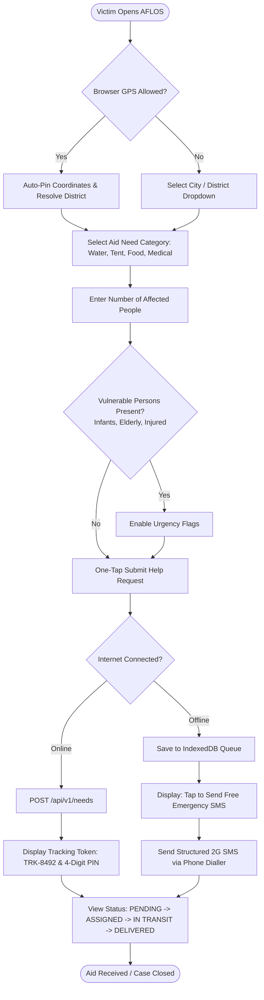
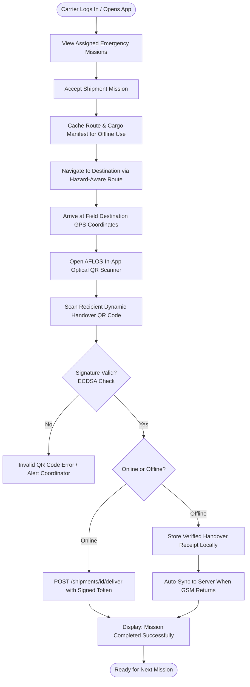
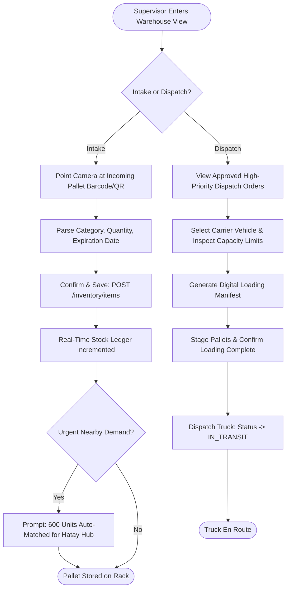

# SENG 321 — Sprint 2 Deliverable 03: UI/UX User-Flow Specifications & Design System Guide

**Project Title:** AFLOS — Disaster Logistics & Aid Coordination System  
**Course:** SENG 321 (BM 321) — Software Engineering Project, Fall 2026  
**Sprint:** Sprint 2 — Requirements Engineering, UI/UX Prototyping & Software Architecture  
**Role / Primary Author:** Product Owner & Requirements Engineer — **Kaan Kılınç (230204047)** ([`@kaanklnc`](https://github.com/kaanklnc))  
**Repository:** [https://github.com/CoskunerBerke/AFLOS](https://github.com/CoskunerBerke/AFLOS)  
**Document Version:** 1.0.0 (Release 1 Baseline)  
**Status:** Approved for Figma UI/UX Prototyping  

---

## Executive Summary

Designing user interfaces for disaster logistics demands an entirely different paradigm than standard consumer applications. Users are either **citizens experiencing severe acute trauma** (shaking hands, low phone battery, cracked screens, bright outdoor sunlight) or **exhausted first responders and truck drivers** operating under extreme fatigue. 

This document defines the comprehensive **User-Flow Architecture**, **Screen-by-Screen Functional Specifications**, and the foundational **Design System Tokens** required to construct the interactive high-fidelity Figma prototypes for AFLOS Release 1.

---

## 1. Disaster UI/UX Design Principles

Every interface designed in Figma and implemented in code must adhere to the **Five Disaster UX Principles**:

1. **Zero-Cognitive Friction (3-Click Rule):** A panic-stricken victim must be able to complete a critical life-saving request in $\le 3\text{ clicks/taps}$ without reading lengthy instructional text.
2. **Sub-Second Offline Feedback:** Interfaces must never hang or show infinite loading spinners during connectivity dropouts. Taps must immediately acknowledge state (`Saved locally to device queue`) within $\le 50\text{ ms}$.
3. **High-Contrast Outdoor Legibility:** Color schemes must maintain at least a **4.5:1** contrast ratio (WCAG 2.1 AA) so that screens remain readable under direct blinding sunlight in the rubble field.
4. **Fat-Finger Touch Targets:** All clickable interactive buttons, checkboxes, and tabs must have a minimum physical bounding box of **$48 \times 48\text{ dp/px}$** with at least $8\text{px}$ margin to prevent accidental misclicks.
5. **Multi-Modal Accessibility:** Critical statuses must be communicated through **triple redundancy**: visual color, descriptive icon, and plain-text badge (e.g., Red + Exclamation Icon + "URGENT" text) to assist color-blind users and non-native speakers.

---

## 2. Design System Tokens & Typography (For Figma Implementation)

### 2.1 Color Palette Tokens

| Token Name | Hex Code | Purpose / Usage | WCAG Contrast |
|---|---|---|---|
| `--color-primary-red` | `#DC2626` | Emergency actions, high-urgency alerts, SOS banners | 4.8:1 on white |
| `--color-primary-dark` | `#991B1B` | Active state of emergency buttons | 7.1:1 on white |
| `--color-accent-amber` | `#D97706` | Medium priority alerts, warehouse warnings, pending states | 4.6:1 on white |
| `--color-accent-blue` | `#2563EB` | Carrier routes, verified logistics hubs, informational links | 4.9:1 on white |
| `--color-success-green` | `#16A34A` | Completed deliveries, verified QR scans, safe status | 4.7:1 on white |
| `--color-neutral-900` | `#0F172A` | Primary typography, headers, high-contrast dark elements | 15.8:1 on white |
| `--color-neutral-600` | `#475569` | Secondary metadata, timestamps, helper labels | 5.2:1 on white |
| `--color-neutral-100` | `#F1F5F9` | Card backgrounds, table alternate shading | Non-text UI |
| `--color-surface-white` | `#FFFFFF` | Primary screen canvas background | Baseline |

### 2.2 Typography Scale (Inter / Roboto)
* **Display Header (H1):** `32px / 40px Bold` — Emergency landing titles.
* **Section Header (H2):** `24px / 32px SemiBold` — Module sections, modal titles.
* **Component Header (H3):** `18px / 24px SemiBold` — Card headings, table columns.
* **Body Regular:** `16px / 24px Regular` — Form inputs, general content.
* **Body Small / Captions:** `14px / 20px Medium` — Timestamps, badges, secondary labels.
* **Emergency Large Numbers:** `48px / 56px Bold Monospace` — Tracking tokens (`TRK-9481`), verification PINs.

### 2.3 Responsive Layout Breakpoints
* **Mobile (Compact):** `375px - 428px` (Primary target for Citizens, Carriers, Field Staff).
* **Tablet (Medium):** `768px - 1024px` (Field Warehouse Tablet terminals).
* **Desktop (Expanded):** `1280px - 1920px` (Crisis Command Center multi-monitor GIS consoles).

---

## 3. Core Persona User-Flows & Logic Diagrams

---

### 3.1 Flow 1: Disaster Victim / Citizen Need Submission Flow (`PER-01`)



#### Detailed Screen Specifications for Citizen Flow:
1. **Screen C-01: Rapid Emergency Landing Screen**
   * *Components:* Emergency Alert Banner, Large "I NEED HELP" Red Button (`#DC2626`), "I WANT TO VOLUNTEER" Secondary Button, Language Toggle (TR / EN / AR).
   * *Behavior:* Zero splash screens or onboarding carousels; instant interactive state upon load.
2. **Screen C-02: Categorical Need Intake Screen**
   * *Components:* Grid of 6 high-contrast visual tiles with standard icons:
     * 💧 Drinking Water
     * ⛺ Winter Shelter / Tent
     * 🍲 Non-perishable Food
     * 🩹 First Aid & Medical
     * 👶 Infant Formula & Diapers
     * 🔋 Mobile Power / Heating
   * *Counter Widget:* Large `+` / `-` stepper for person count (Default: 1).
   * *Checkbox Chips:* `Infant under 1 yr`, `Elderly over 65`, `Trauma/Bleeding`, `Sub-zero exposure`.
3. **Screen C-03: Confirmation & Tracking Dashboard**
   * *Components:* Big Monospace Token `TRK-8492`, 4-step progress stepper (`Received`, `Approved`, `Dispatched`, `Arrived`), SMS Notification confirmation, "Cancel Request if Aid Already Received" button.

---

### 3.2 Flow 2: Carrier / Driver Shipment Handover Flow (`PER-02`)



#### Detailed Screen Specifications for Carrier Flow:
1. **Screen D-01: Carrier Mission Cockpit**
   * *Components:* Active Mission Card: Cargo Summary (e.g., "50 Tents, 500L Water - 1,200 kg"), Origin Hub, Target Coordinates, Destination Contact, "Start Journey" swipe button.
2. **Screen D-02: Hazard Route Navigation Screen**
   * *Components:* Embedded MapLibre vector map showing designated green corridor, hazard warning markers (e.g., "Bridge Collapsed on D-825 - Take Bypass Road"), "Emergency SOS / Breakdown" button.
3. **Screen D-03: QR Optical Handover Scanner**
   * *Components:* Camera viewfinder with target alignment grid, flashlight toggle, manual fallback input box for 8-character token, instant tactile haptic vibration on successful scan.

---

### 3.3 Flow 3: Field Warehouse Supervisor Intake & Dispatch Flow (`PER-03`)



#### Detailed Screen Specifications for Warehouse Flow:
1. **Screen W-01: Warehouse Inventory Overview**
   * *Components:* Total Available Stock Counters categorized by Sphere Taxonomy, Low Stock Warning Bar ($<20\%$ threshold highlighted in bright amber `#D97706`), "Quick Intake Scan" floating action button.
2. **Screen W-02: Rapid Intake Scanner Screen**
   * *Components:* Live optical scanner, detected item preview card, batch expiration date picker, quantity counter, "Accept Pallet" audio-visual confirmation.
3. **Screen W-03: Vehicle Manifest Staging Screen**
   * *Components:* Vehicle weight and volume progress bars (e.g., "Weight: 8,400 kg / 10,000 kg [84%]"), item checklist, printable/shareable PDF/QR manifest generator.

---

### 3.4 Flow 4: Crisis Command Coordinator Situational Dashboard Flow (`PER-04`)

```mermaid
flowchart TD
    CoordStart([Coordinator Logs into Incident Command]) --> LoadGIS[Load Regional Real-Time GIS Heatmap]
    LoadGIS --> ApplyFilters[Filter by Disaster Region, Need Category, Urgency Level]
    
    ApplyFilters --> InspectClusters[Inspect High-Intensity Demand Clusters (Red Heat)]
    InspectClusters --> ViewBottleneck{Bottleneck Alert Active?<br/>Demand > Supply for > 12h}
    
    ViewBottleneck -- Yes --> ReviewBottleneck[Open Bottleneck Detail Modal]
    ReviewBottleneck --> DivertSupplies[Trigger Supply Diversion from Nearest Central Hub]
    
    ViewBottleneck -- No --> MatchOrders[Review Automated Need-Supply Matching List]
    MatchOrders --> ApproveDispatch[One-Click Batch Approval for Convoys]
    DivertSupplies --> ApproveDispatch
    
    ApproveDispatch --> LogAudit[Immutable Security Audit Record Appended]
    LogAudit --> BroadcastUpdate[WebSockets Push Updates to Carrier & Warehouse Apps]
    BroadcastUpdate --> MonitorMap([Monitor Live En-Route Convoys])
```

#### Detailed Screen Specifications for Coordinator Flow:
1. **Screen K-01: Macro GIS Situational Command Center**
   * *Components:* Full-screen interactive MapLibre map with layer toggles (Needs Heatmap, Warehouses, En-Route Trucks, Blocked Roads), Top Metric Strip: Total Affected ($48,210$), Total Dispatched ($312\text{ tons}$), Bottleneck Warnings ($4$).
2. **Screen K-02: Bottleneck Resolution Modal**
   * *Components:* Detailed split-view showing local deficit (e.g., "Defne District: 4,000 tents needed, local stock: 200"), recommended surplus donor warehouse (e.g., "Mersin Central Hub: 12,000 tents available"), "Authorize Emergency Convoy" button with mandatory justification input field.
3. **Screen K-03: Security & Allocation Audit Console**
   * *Components:* Immutable, chronological table listing all dispatch overrides, user IDs, timestamps, and cryptographic transaction IDs with CSV/JSON export capability.

---

## 4. Figma Prototype Structure & Wireframe Asset Architecture

To ensure high-scoring compliance with the BM 321 evaluation rubric, the Figma project must be organized into four distinct pages:

```
AFLOS Figma Project
│
├── Page 1: Design System & Components (Colors, Typography, Buttons, Inputs, Icons)
│
├── Page 2: Citizen Mobile PWA (Screens C-01 to C-03 + Offline SMS Modals)
│
├── Page 3: Carrier & Warehouse Mobile/Tablet (Screens D-01 to D-03 & W-01 to W-03)
│
└── Page 4: Coordinator Desktop GIS Dashboard (Screens K-01 to K-03 + Bottleneck Views)
```

### 4.1 Interactive Figma Prototyping Interactions
* **Citizen Flow:** Prototype hot-spot connecting `Screen C-01` $\rightarrow$ Tap "I Need Help" $\rightarrow$ `Screen C-02` (Select Water/Tent) $\rightarrow$ Tap "Submit" $\rightarrow$ Micro-interaction loading spinner ($300\text{ ms}$) $\rightarrow$ `Screen C-03` with animated progress stepper.
* **Carrier Flow:** Prototype connecting `Screen D-01` $\rightarrow$ Tap "Start Mission" $\rightarrow$ `Screen D-02` (Hazard Map) $\rightarrow$ Tap "Verify Delivery" $\rightarrow$ `Screen D-03` (Camera Overlay) $\rightarrow$ Tap QR Code $\rightarrow$ Confirmed Green Checkmark modal.
* **Coordinator Flow:** Desktop frame with interactive dropdown filters changing map marker cluster colors from Blue to Amber to Pulsing Red.

---

## 5. Sign-off and Handover to UI/UX Designers

This document serves as the binding visual and behavioral contract between the Product Owner and the UI/UX prototyping team:

* **Document Owner / Product Owner:** Kaan Kılınç ([`@kaanklnc`](https://github.com/kaanklnc))
* **Design Implementation Target:** Figma Cloud Project (`AFLOS - Disaster Logistics Team 2`)
* **Reviewers:**
  * Lead Software Architect: Mirza Akgöz ([`@akgozmirza`](https://github.com/akgozmirza))
  * Lead Software Architect: Hüseyin Zor ([`@kurdoglu25`](https://github.com/kurdoglu25))
  * QA Test Automation Lead: Onur Şahin ([`@clickOMorphism`](https://github.com/clickOMorphism))
  * Scrum Master: Mustafa Çebin ([`@Noct-0`](https://github.com/Noct-0))
